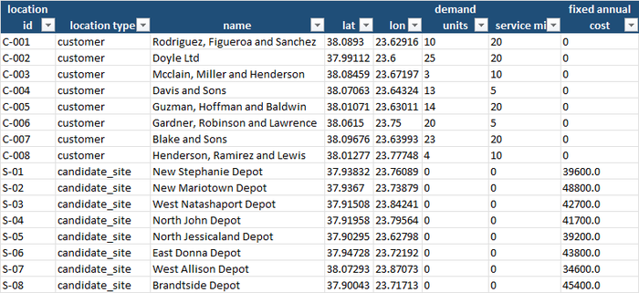
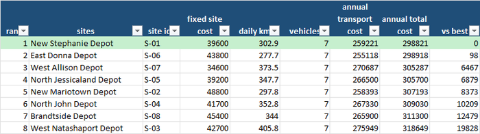
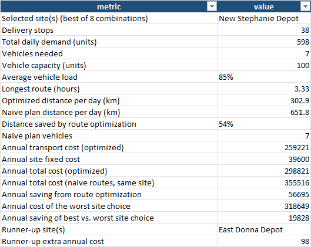
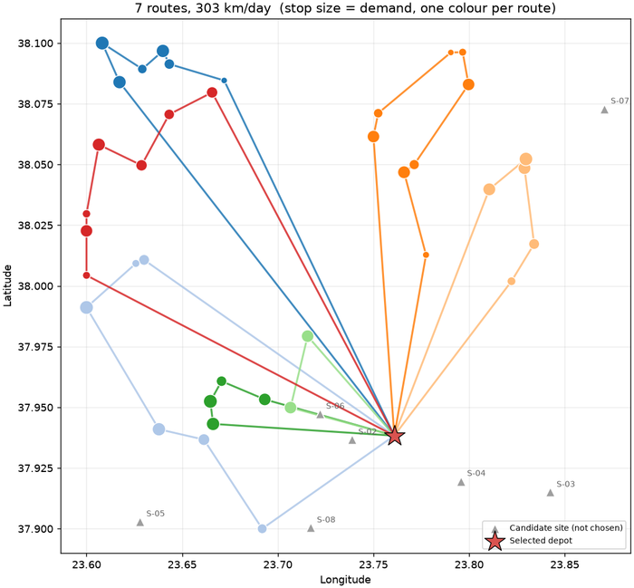
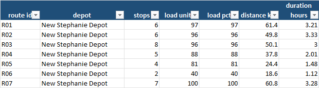
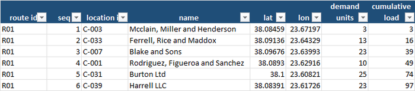

Ask the owner of a small distribution business how the delivery routes were decided and
the answer is usually a story: "Nikos has driven the north run for ten years, so he knows
it." Ask why the depot is where it is and the answer is another story: "It was the
cheapest unit we could find when we started." Both decisions are made once, rarely
revisited, and repeated every working day for years. A van that drives 20 kilometres
further than it needs to, 250 days a year, is a cost nobody ever sees on an invoice.

This blog keeps returning to one idea: replace gut feel with a number. The
[inventory control](/2026/07/27/inventory-control-for-Small-and-Medium-companies/) post put
a number on how much stock to hold; the
[staffing](/2026/10/18/how-many-staff-do-you-actually-need-on-a-saturday/) post put one on
how many people a Saturday needs; the
[OTIF](/2026/09/07/are-your-orders-arriving-on-time-and-in-full/) post measured whether
orders arrive on time. This post turns to the physical side of the same question: *where
should the depot be, and what route should each vehicle drive?* The method is **location
and routing optimization** — evaluate every candidate site, plan the routes from each one,
and compare the **total annual cost** of the whole set-up, not just the rent.

For a small or medium-sized company this matters for a simple reason: transport is
usually one of the three or four biggest controllable costs, and it is controlled almost
entirely by habit. You do not need a logistics department or specialised software to ask
the question properly. The arithmetic is old, the inputs are a customer list with
addresses, and the answer fits in an Excel workbook.

## What location and routing optimization actually gives you

| Benefit | Why it matters for an SME |
|---|---|
| **A real price tag on the depot decision** | Every candidate site is compared on one number: fixed site cost plus the cost of driving the routes from it. A cheap site far from your customers can cost more than an expensive central one — and the reverse. |
| **Routes that waste fewer kilometres** | The routes are built to keep stops that are close together on the same vehicle, in a sensible order, instead of in the order the orders came in. Fewer kilometres means less fuel, less wear and less driver time. |
| **A check on how many vehicles you really need** | Vehicle count is driven by capacity: total daily load divided by what one vehicle carries. The plan shows how full each vehicle really is and where one half-empty run is quietly costing you a whole vehicle. |
| **A fair test of "should we open a second depot?"** | The tool re-plans the routes for one, two or three depots and shows what each does to the total. A second site only pays if it saves more driving than it adds in fixed cost. |
| **A baseline to beat** | The workbook compares the optimized plan with a naive one that simply fills vehicles in the order customers appear in the data — roughly what an unplanned system does — so the saving is stated in euros, not adjectives. |
| **Plans a driver can follow** | Every route comes out as a list of stops in order, with load and duration, ready to print or paste into a navigation app. |
| **Bad data never reaches the plan** | A validation step rejects coordinates that don't exist, negative demand, unknown location types, blanks and duplicates before anything is optimized. |

## A practical example, using this repo's own results

This repository — **[Location-routing-optimization](https://github.com/MattProtopapas/Location-routing-optimization)**
— ships with a full worked example. The scenario is a fictitious small distributor serving
customers around **greater Athens**: 40 delivery stops clustered in four neighbourhoods,
each with a daily demand in units and a service time at the door, plus **eight candidate
depot sites**, each with a yearly fixed cost that is higher the closer it is to the centre.
Vehicles carry **100 units**, may be out for at most **8 hours**, average 30 km/h in the
city, and cost **€0.65 per kilometre** plus **€120 a day** for the vehicle and driver. The
network operates **250 days a year**.

The raw file has **49 rows** — 40 customers, 8 sites and one deliberately duplicated
record. The validator rejected **3**: one with a customer mislabelled as a depot
candidate (a site with no yearly cost), one with a blank name, and the duplicate of site
S-08. That leaves **38 customers and 8 candidate sites**. Note what that means in real
life: two genuine customers dropped out of the plan because of bad data, and a validation
report that does not get read means two customers who never get a delivery slot.



## Where to put the depot: the answer is closer than you'd think

The **Site Comparison** tab evaluates every candidate, plans the routes from it, and ranks
them by total annual cost:



The best site, **New Stephanie Depot**, costs **€298,821 a year** in total — €39,600 of
site cost plus €259,221 of transport. The worst, West Natashaport, costs **€318,649**. The
site decision alone is worth **€19,828 a year**, about 6% of the total, for the price of
looking at all eight.

Two details are more instructive than the winner:

- **The runner-up is a near tie.** East Donna Depot costs **€98 a year more**. It rents for
  €4,200 more but saves 25 km a day on the road — the two effects nearly cancel. When two
  options are that close, the number has done its job: it tells you the decision should be
  made on something the model cannot see, such as lease terms, access for lorries or
  growth room.
- **The cheapest site is not the cheapest option.** West Allison Depot has the lowest fixed
  cost of the eight (€34,600) but sits far enough out that the vans drive about 70 extra
  kilometres a day. It finishes third, **€6,467 a year** behind the winner. A rent saving
  that looks decisive on a lease comparison is overwhelmed by the daily driving it causes.

## What the routes look like

The **Summary** tab states the plan in business terms:



The optimized plan needs **7 vehicles** to deliver **598 units** a day across 38 stops,
driving **302.9 km** a day. The naive plan — vehicles filled in data order — needs the same
7 vehicles but drives **651.8 km**: more than double. The difference, **349 km a day over
250 days at €0.65**, is **€56,695 a year**, a 16% saving on the total, from nothing more
than putting nearby customers on the same van in a sensible order.



The map is the quickest way to see what is going on. Each colour is one vehicle; each dot
is a customer, sized by demand. Because the depot sits at the southern edge of the network, most
routes begin with a long drive out to a cluster of customers, work their way round it and
come back — the long legs are the price of that site, and the reason the site comparison
matters.

The **Routes** tab gives each vehicle's load, distance and duration:



Read down the load column and two things stand out. Six of the seven vehicles are filled
to **81–100%**. One, route R06, carries **40 units on two stops** — a vehicle and driver
costing €120 a day for 40% of a load. And the longest route takes **3.3 hours** against an
allowed 8: *capacity*, not time, is what determines how many vehicles are needed. That is
useful to know. It says the lever for cost is not squeezing drivers' hours; it is how
cleanly the daily load packs into vehicles.

A word on the arithmetic of that. 598 units divided by a 100-unit vehicle is 5.98, so
six vehicles would need to leave **99.7% full** — not realistic with 38 separate drop
sizes. Seven is the right answer for this load. But the **vehicle-and-driver cost is
€210,000 a year, 81% of the transport bill**, against only €49,000 for fuel and running
costs. A day with a few more or fewer units of demand can tip the plan from seven vehicles
to eight, which is why capacity — a 120-unit van, or a smaller delivery window for a
shared customer — is worth pricing before the next route review.

Finally, **Route Stops** gives the stop-by-stop sequence, with the cumulative load, that a
driver or dispatcher can actually use:



## Should we open a second depot?

The question every growing distributor asks. The demo can answer it by changing one flag:
`--num-sites 2` evaluates all 28 pairs of sites, `--num-sites 3` all 56 triples. Here is
what happens:

| Depots | Best combination | Vehicles | km/day | Total annual cost |
|---|---|---|---|---|
| 1 | New Stephanie | 7 | 303 | **€298,821** |
| 2 | North Jessicaland + West Allison | 7 | 271 | €327,791 |
| 3 | New Stephanie + North Jessicaland + West Allison | 7 | 289 | €370,402 |

A second depot cuts daily distance by about 10%, which saves roughly €5,000 a year in
running costs, but adds **€34,000 of fixed cost**. It would pay for itself only with
more customers, longer routes, or a high enough vehicle cost that the shorter distance
freed up an entire vehicle — and in this network it does not. The point is not that one
depot is always right. It is that the question has an answer you can calculate, instead of
a gut feeling about "being closer to the customer".

## The business impact, in real numbers

Put a cost on what the workbook found:

1. **Routing the same 38 stops sensibly saves €56,695 a year** against the naive plan, 16%
   of the whole bill, with no change to vehicles, depot or customers.
2. **Choosing the right depot is worth up to €19,828 a year** against the worst site — and
   the cheapest-to-rent site was *not* the best one.
3. **Two sites were effectively tied** (€98 a year apart), which tells you where to stop
   optimizing and start negotiating.
4. **A second depot would cost about €29,000 a year more**, not less, on this network.
5. **Vehicle cost, not fuel, is the real lever.** 81% of the transport bill is the
   vehicle-and-driver day rate; the half-empty vehicle on route R06 is the most expensive
   line on the plan.
6. **The data-quality dividend.** Two customers were dropped because of corrupted records.
   A plan built on an unvalidated list silently misses them.

## What to actually do with this, this week

1. **Export your delivery list with coordinates and demand.** One row per customer, with
   latitude and longitude (any spreadsheet mapping add-on will geocode addresses), the
   typical load per drop and the time spent at the door. This is the input file.
2. **List every depot or yard you could realistically use,** including the one you
   already have, with its yearly cost. Include the awkward options — you want the
   comparison to be honest.
3. **Run the plan for your current site first and read the Summary tab.** If the
   naive-versus-optimized gap is large, route planning alone is your first saving.
4. **Look at the load column before anything else.** A vehicle that is half-empty is a
   conversation about delivery days, minimum orders or customer groupings.
5. **Compare sites on total cost, not rent.** Check the gap between the best site and the
   runner-up; if it is small, decide on the things the model cannot see.
6. **Re-run it when the customer list changes by 10–15%.** Routes drift; the plan should
   be refreshed when your customers move.

## Try it yourself: a demo you can run in minutes

To make this concrete, **[Location-routing-optimization](https://github.com/MattProtopapas/Location-routing-optimization)**
is a small, self-contained, open-source Python pipeline. It:

1. Generates a fake delivery network around Athens — customers clustered in neighbourhoods
   with demand and service times, and candidate depot sites whose rent rises towards the
   centre — with a configurable share of deliberately corrupted rows.
2. Validates every row against a strict schema, drops duplicates and writes a rejection
   report with a reason for each dropped row.
3. Evaluates every site combination, plans the vehicle routes for each, and writes the
   result into a **6-tab Excel workbook** plus a route map.

### Downloading the code (no Git experience needed)

You don't need to know Git or the command line to get the code onto your computer:

1. Go to the repository: **[github.com/MattProtopapas/Location-routing-optimization](https://github.com/MattProtopapas/Location-routing-optimization)**
2. Click the green **`<> Code`** button near the top of the page.
3. Click **"Download ZIP"** in the dropdown.
4. Right-click the downloaded ZIP and choose **"Extract All..."** to unzip it into a
   regular folder.
5. Open that folder — that's the project. Ask your AI tool of choice (I used Claude) to
   set up a Python environment and install the dependencies listed in
   `requirements.txt` — no coding experience required to get it running.

If you're comfortable with Git,
`git clone https://github.com/MattProtopapas/Location-routing-optimization.git` does the
same thing in one step.

### Running the demo

The repository includes a full `README.md`, but the short version, from PowerShell
(requires Python 3.10+; the optimization itself is plain standard-library Python —
`matplotlib` is only used for the map):

```powershell
python -m venv .venv
.\.venv\Scripts\Activate.ps1
pip install -r requirements.txt

python generate_data.py --customers 40 --sites 8 --error-rate 0.05 --seed 42   # step 1: fake delivery network
python validate_data.py                                                         # step 2: schema checks, rejection report
python analyze_routes.py --num-sites 1                                          # step 3: site selection + routing -> Excel + map
```

Then open `output/routing_analysis.xlsx`. With `--seed 42` you'll get exactly the numbers
quoted in this post; the workbook committed to the repository's `output/` folder was
produced the same way, so you can also just browse it on GitHub without running anything.

Try `--num-sites 2` to see where a second depot would go, and the options on the
analysis step to match your own business: `--vehicle-capacity`, `--max-route-hours`,
`--speed-kmh`, `--cost-per-km`, `--vehicle-daily-cost` and `--operating-days`. Changing
the vehicle capacity from 100 to 120 is a quick way to see how much of the bill is the
number of vans.

Every input and output path is defined in one place in `routing_common.py`, so once
you're comfortable with the demo you can drop your own customer and site list — one row
per location with a type, coordinates, daily demand, service time and, for candidate
sites, a yearly cost — into `data/`, skip `generate_data.py` entirely, and run
`validate_data.py` and `analyze_routes.py` straight on your own network.

> **Note:** the sample data shipped with this repo is synthetic and randomly generated,
> and this project is intended for educational and demonstration purposes only — see the
> repository's
> [Disclaimer & EULA](https://github.com/MattProtopapas/Location-routing-optimization/blob/main/DISCLAIMER.md)
> for details. It's a starting point for understanding how site selection and vehicle
> routing work, not a fleet-management system.

## Understanding the results

The workbook — `output/routing_analysis.xlsx` — has six tabs.

**The verdict.** *Summary* — the key numbers in one table: stops, daily demand, vehicles,
average load, longest route, kilometres, costs, and the savings against the naive plan
and the worst site. It is the one tab to hand to whoever signs off the budget.

**The comparison.** *Site Comparison* — every site (or combination) ranked by total annual
cost, best highlighted, with the gap to the best in the last column.

**The plan.** *Routes* — one row per vehicle: stops, load, load percentage, distance,
duration and the stop sequence. *Route Stops* — the same, one row per stop, with
coordinates and cumulative load. *Route Map* — the picture above.

**The input.** *Input Data* is the validated location file exactly as the optimizer read
it. Alongside it, `data/validation_report.txt` lists every rejected row and why.

## The limits worth keeping in mind

Location and routing optimization, like every tool covered on this blog, is genuinely
useful within real limits:

- **Distances are estimates.** The tool uses straight-line distance multiplied by 1.3 to
  approximate roads, and a flat 30 km/h. Real routes have one-way streets, rivers and
  rush hours. For a real decision, replace the distance matrix with one from a routing
  service.
- **The routes are very good, not provably the best.** The method — merging routes where
  it saves the most distance, then removing crossing legs within each route — is a
  well-known heuristic, typically within a few percent of the optimum. Treat the plan as
  a strong starting point, not a certificate.
- **Delivery windows and driver rules are missing.** There are no customer opening hours,
  mixed vehicle sizes, break rules or return loads. Each would make the real plan costlier
  than the model's.
- **One day stands in for 250.** Demand varies by day of the week and the season, so a
  plan built on an average day will be wrong on a peak day. Re-run it on your busiest day
  as well.
- **Site costs come from the list you gave it.** The result is only as good as your
  estimate of rent, rates and staffing for each candidate. Sensitivity matters here: the
  winner and runner-up were €98 apart.
- **Two real customers were lost to bad data.** The validation step caught them; it can't
  fix them. Read the rejection report and repair the rows.

None of that diminishes the core value. The customer list already exists. The routing
arithmetic is decades old and runs in seconds on a laptop. What it changes is not that you
have a depot and a set of routes, but that you know what they cost — and, when the honest
answer is "about the same as the alternative", that you can stop worrying and spend the
effort on the next decision, such as [how many staff](/2026/10/18/how-many-staff-do-you-actually-need-on-a-saturday/)
you need to load the vans in the morning.
