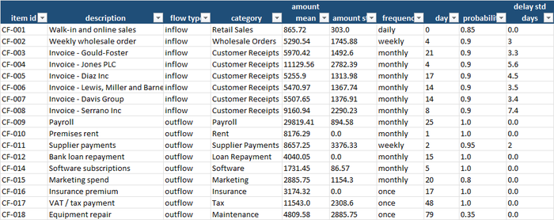
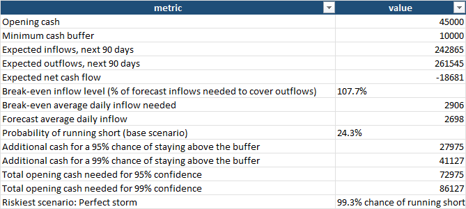
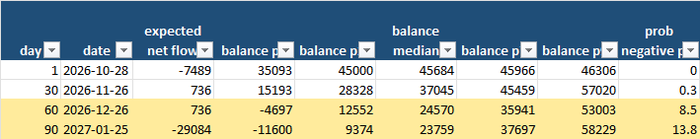
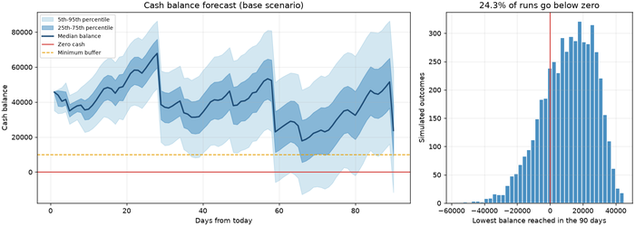
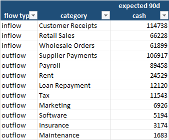
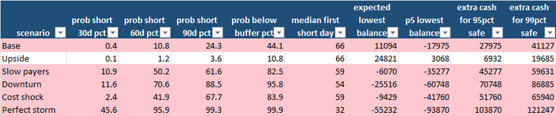

Ask the owner of a small company whether the business can get through the next quarter
and the answer is usually quick and confident: "Yes, we have €45,000 in the bank and the
forecast says we end the quarter on about €26,000." Ask what happens if two of the big
customers pay a week late, whether the €26,000 is the lowest the account will go or just
where it ends up, and how likely it is that payroll bounces on the 25th, and the answer
slows down: "Well, it should be fine."

This blog keeps returning to one idea: replace gut feel with a number. The
[capital budgeting](/2026/08/08/how-can-companies-decide-which-capital-projects-to-fund/)
post asked which long-term projects deserve money; the
[working capital](/2026/08/27/how-much-working-capital-should-be-tied-up-in-inventory/)
post asked how much cash is tied up in stock. This post is the day-to-day cash view that
sits underneath both: *what is the chance we run short of cash in the next 90 days, and
how much cash do we actually need to hold?* The method is a **Monte Carlo cash-flow
simulation** — run the next 90 days thousands of times, each time letting customers pay a
little early or a lot late, bills come in a bit higher or lower, and an occasional
repair or surprise land — and count how often the balance goes wrong.

For a small or medium-sized company this matters more than almost anything else on this
blog, because **companies rarely fail for being unprofitable — they fail for running out
of cash on a Tuesday**. A profitable business with slow-paying customers can be
insolvent; a business with a thin cash buffer and a monthly payroll has very little room
for a bad week. And the usual tool for looking ahead, a spreadsheet with one expected
number per line, cannot show the thing you most want to see: the *range* of outcomes and
the *worst moment*, not the average end of the quarter.

## What a cash simulation actually gives you

| Benefit | Why it matters for an SME |
|---|---|
| **A probability instead of a reassurance** | "There is a 24% chance we dip below zero in the next 90 days" is a number you can plan around. "It should be fine" is not. |
| **The lowest point, not just the end point** | An account that ends the quarter at €26,000 can be at −€12,000 on the 26th. The simulation tracks every day, so it shows the dip, not just the destination. |
| **How much cash is enough** | The extra buffer you need for a 95% or 99% chance of staying above your minimum cushion, in euros. That is the size of the credit line to negotiate, or the amount to leave in the business before taking a dividend. |
| **What slow-paying customers really cost** | One scenario moves every customer payment back a week. The impact on the chance of a shortfall is usually far bigger than a few percent of lost sales. |
| **A stress test for the bad quarter** | Six scenarios — upside, slow payers, downturn, cost shock, "perfect storm" — run on the same random numbers, so differences between them come from the scenario, not luck. |
| **The break-even level of sales** | The share of forecast inflows that must actually arrive to cover outflows: your real margin for error, stated as a percentage. |
| **Honest data handling** | A validation step rejects negative amounts, impossible frequencies, out-of-range probabilities, blanks and duplicates before the simulation runs. |

## A practical example, using this repo's own results

This repository — **[break-even-analysis](https://github.com/MattProtopapas/break-even-analysis)**
— ships with a full worked example. The scenario is a fictitious small business with
**€45,000 in the bank** and a **minimum cushion of €10,000** it never wants to dip below.
It has 17 recurring cash items, each described by an amount and its variability, a
schedule (daily, weekly, monthly or one-off), the probability that it happens at all, and
how many days its timing can slip:

- **Money in:** daily walk-in and online sales (about €866 a day, happening 85% of days),
  a weekly wholesale order of about €5,300, and **six monthly customer invoices**
  ranging from €5,300 to €11,100. Customers' payment timing can slip by 3 to 7 days.
- **Money out:** payroll of about **€29,800 on the 25th**, rent of €8,176 on the 1st,
  weekly supplier payments of about €8,700, a loan repayment of €4,040, software, insurance,
  marketing, a one-off tax payment of €11,543 about seven weeks in, and an **equipment
  repair** that has only a 35% chance of happening at all.

The raw file has **19 rows**; the validator rejected **2** — one item with a non-positive
amount (CF-013) and a duplicated ID — leaving 17. As elsewhere in this series, that is
a real-life warning: the rejected row was a genuine cash item, so the forecast is missing
one of the business's costs until somebody repairs it.



## The average forecast looks comfortable. The simulation does not.

The **Break-Even** tab starts with the arithmetic a normal forecast would do:



Over the next 90 days the business expects **€242,865 of cash in and €261,545 out**: a net
outflow of **€18,681**. Starting from €45,000, the spreadsheet answer is an ending
balance of about **€26,300** — comfortably above the €10,000 cushion. Most owners would
stop there.

The simulation says otherwise. Running the 90 days 5,000 times:

- In **24.3% of runs the balance goes below zero** at some point.
- In **44.1% of runs it dips below the €10,000 cushion**.
- To have a **95% chance** of staying above the cushion, the business needs **€27,975 more**
  than it has — **€72,975 in total**. For a 99% chance, **€41,127 more** (€86,127).
- Because outflows exceed inflows, **forecast inflows would have to be 107.7% of plan**
  just to break even. Average daily inflow is €2,698; the business needs **€2,906**.

Why is the risk so much higher than the average suggests? Because cash is not an average.
The big outflows are **lumpy** — payroll alone takes €29,800 on a single day — while the
inflows are scattered, and a late invoice that arrives three days after payroll is just as
bad as one that never arrives. A forecast that says "we receive €242,000 over the
quarter" cannot tell the difference.

## When will it go wrong?

The **Daily Forecast** tab and the chart show the whole fan of outcomes, day by day:





Read the left-hand chart as a sawtooth. Cash builds through the month, then drops
sharply on each payroll date — around days 29, 59 and 90 — and the shaded band (the
range of outcomes) gets wider the further out you look. The median balance falls from
about **€37,000** at the end of the first month to **€24,600** after the second
payroll. By **day 60** the worst 5% of runs are already at **−€4,700**, and the
**chance of a negative balance** that day is **8.5%**. On the last day — which is itself
payroll day, 25 January — the 5th-percentile balance is **−€11,600**.

The right-hand chart is the one to show a banker: the distribution of the *lowest balance
reached* during the quarter. Everything to the left of the red line is a run that went
overdrawn.

## What drives the cash, and what happens in a bad quarter

Where does the money actually come from and go? The **Cash Drivers** tab adds up
the expected 90-day cash by category:



Two outflows — **supplier payments (€106,917) and payroll (€89,458)** — account for 75%
of everything that leaves. On the other side, **six customer invoices bring in €114,738,
47% of the inflow**, and they are the items with the most uncertain timing. That is where
the scenarios go next:



| Scenario | What changes | Short within 90 days | Extra cash for 95% safe |
|---|---|---|---|
| Base | as forecast | **24.3%** | €27,975 |
| Upside | sales +10%, less volatility | 3.6% | €6,932 |
| Slow payers | customers pay **7 days later** | **61.6%** | €45,277 |
| Cost shock | outflows +10% | 67.7% | €51,760 |
| Downturn | sales −15%, +3 days late, more volatile | 88.5% | €70,748 |
| Perfect storm | sales −15%, costs +10%, +5 days late | **99.3%** | €103,870 |

Three things are worth taking from that table. **First, a one-week delay in customer
payments alone raises the chance of a shortfall from 24% to 62%** — almost as damaging as
a 10% rise in every cost (68%). Timing matters about as much as amounts. **Second, in the
Perfect Storm** the median day on which the business first goes negative is **day 32**,
with a 46% chance of being short by day 30. **Third, the Upside scenario** shows what a
modest 10% sales gain does for cash: the extra buffer needed falls from €27,975 to
€6,932. Sales growth is the cheapest financing there is.

## The business impact, in real numbers

Put a cost on what the workbook found:

1. **The comfortable average hides a one-in-four chance of going overdrawn.** The
   forecast says the quarter ends at €26,300; the simulation says 24% of runs go below
   zero on the way.
2. **A bank balance of €45,000 is about €28,000 short of a 95% comfort level** and €41,000
   short of 99%. That is the size of the overdraft facility or cash reserve to arrange
   *before* it is needed — not during the week it is needed.
3. **Customer payment speed is a financing decision.** Seven days of lateness takes the
   shortfall risk from 24% to 62%. Chasing six invoices can be worth more than
   most cost-cutting.
4. **The business is structurally short.** Outflows exceed inflows by €18,681 over the
   quarter; even before any bad luck, sales must run 7.7% above plan just to stand still.
5. **Payroll day is the danger date.** The sawtooth shows that the deepest troughs follow
   the 25th. Moving a large supplier payment away from that date, or invoicing a large
   customer the week before, is a cheap fix.
6. **The data-quality dividend.** One real cash item was dropped for bad data. A forecast
   that silently misses a cost looks better than reality.

## What to actually do with this, this week

1. **List every recurring cash item** — customers, payroll, rent, suppliers, tax, loans,
   software, insurance — with a typical amount, how much it varies, and the day it
   normally lands. Twenty rows are enough.
2. **Estimate how late each customer really pays**, not how late they are supposed to.
   Your accounts-receivable ageing report gives you the delay for free.
3. **Run the simulation with today's real balance and the minimum you are willing to see.**
   Read the probability of running short and the extra cash needed for 95% safety.
4. **Look at the fan chart for the first dip.** Which date is the pinch point? That is the
   conversation to have with your bank and your largest customer.
5. **Run the slow-payers scenario for your top three customers.** If the answer scares you,
   consider early-payment discounts, deposits or invoicing earlier.
6. **Refresh it monthly.** A cash model is a weather forecast, not a plan; its value is in
   being updated.

## Try it yourself: a demo you can run in minutes

To make this concrete, **[break-even-analysis](https://github.com/MattProtopapas/break-even-analysis)**
is a small, self-contained, open-source Python pipeline. It:

1. Generates a fake small business's recurring cash items — customer invoices, retail
   sales, payroll, rent, suppliers, a loan, tax and an equipment repair — each with an
   amount, variability, schedule, probability and payment-delay spread, plus a
   configurable share of deliberately corrupted rows.
2. Validates every row against a strict schema, drops duplicates and writes a rejection
   report with a reason for every dropped row.
3. Runs the Monte Carlo simulation under six scenarios — 5,000 runs each, about 15 seconds
   in total — and writes the results into a **6-tab Excel workbook** plus a chart.

### Downloading the code (no Git experience needed)

You don't need to know Git or the command line to get the code onto your computer:

1. Go to the repository: **[github.com/MattProtopapas/break-even-analysis](https://github.com/MattProtopapas/break-even-analysis)**
2. Click the green **`<> Code`** button near the top of the page.
3. Click **"Download ZIP"** in the dropdown.
4. Right-click the downloaded ZIP and choose **"Extract All..."** to unzip it into a
   regular folder.
5. Open that folder — that's the project. Ask your AI tool of choice (I used Claude) to
   set up a Python environment and install the dependencies listed in
   `requirements.txt` — no coding experience required to get it running.

If you're comfortable with Git,
`git clone https://github.com/MattProtopapas/break-even-analysis.git` does the same
thing in one step.

### Running the demo

The repository includes a full `README.md`, but the short version, from PowerShell
(requires Python 3.10+; the simulation itself is plain standard-library Python —
`matplotlib` is only used for the chart):

```powershell
python -m venv .venv
.\.venv\Scripts\Activate.ps1
pip install -r requirements.txt

python generate_data.py --customers 6 --error-rate 0.05 --seed 7                  # step 1: fake cash items
python validate_data.py                                                           # step 2: schema checks, rejection report
python analyze_cashflow.py --opening-cash 45000 --buffer 10000 --start-date 2026-10-28   # step 3: simulation -> Excel + chart
```

Then open `output/cashflow_analysis.xlsx`. With `--start-date 2026-10-28` you'll get
exactly the numbers quoted in this post (the start date decides which days payroll and
rent fall on, so it changes the picture slightly if you leave it out); the workbook
committed to the repository's `output/` folder was produced the same way, so you can also
just browse it on GitHub without running anything.

The analysis options are the interesting part, because they let you ask your own
questions: `--opening-cash` and `--buffer` set the bank balance and the cushion you want to
protect, `--sims` sets the number of simulated quarters (more runs, smoother results) and
`--seed` fixes the random numbers. Try halving the opening cash, or doubling the buffer,
and watch the probability of running short respond.

Every input and output path is defined in one place in `cashflow_common.py`, so once
you're comfortable with the demo you can drop your own cash items — one row per recurring
inflow or outflow, with `flow_type`, `amount_mean`, `amount_std`, `frequency`, `day`,
`probability` and `delay_std_days` — into `data/`, skip `generate_data.py` entirely, and
run `validate_data.py` and `analyze_cashflow.py` straight on your own business.

> **Note:** the sample data shipped with this repo is synthetic and randomly generated,
> and this project is intended for educational and demonstration purposes only — see the
> repository's
> [Disclaimer & EULA](https://github.com/MattProtopapas/break-even-analysis/blob/main/DISCLAIMER.md)
> for details. It's a starting point for understanding cash-flow risk, not a treasury
> system.

## Understanding the results

The workbook — `output/cashflow_analysis.xlsx` — has six tabs.

**The verdict.** *Break-Even* — expected inflows against outflows, the break-even inflow
level, the probability of running short, and the cash needed for 95% and 99%
confidence. It is the one tab to hand to a bank manager or a business partner.

**The scenarios.** *Scenario Summary* — chance of running short within 30, 60 and 90
days, the chance of dipping below your cushion, the median first-negative day, the lowest
and ending balance percentiles and the extra cash needed, per scenario (red for 20% or
more, amber for 5–20%).

**The drivers.** *Cash Drivers* — expected 90-day cash in and out by category.

**The day-by-day.** *Daily Forecast* — base-scenario balance percentiles and the
probability of a negative balance, every day. *Chart* — the fan chart and the
distribution of the lowest balance.

**The input.** *Input Data* is the validated cash-item file exactly as the simulation read
it. Alongside it, `data/validation_report.txt` lists every rejected row and why.

## The limits worth keeping in mind

Cash simulation, like every tool covered on this blog, is genuinely useful within real
limits:

- **The inputs are your estimates.** The amounts, variability and delay spreads in the
  demo are illustrative. The output is only as good as the history behind them; use your
  real invoices and payment dates.
- **Items are independent.** In reality one bad week hits everything at once — a slow
  month for sales is also a slow month for payments. The scenarios partly cover this,
  but the base simulation is gentler than a real downturn.
- **Amounts are bell-shaped.** The simulation draws amounts from a normal distribution,
  which cannot produce the odd huge invoice or the lost customer. Real tails are fatter.
- **The model covers 90 days, not a year.** It is a short-range liquidity tool, not a
  funding plan.
- **There is no feedback.** In real life you would delay a supplier payment or draw on a
  credit line when the balance got low. The simulation lets the account run down without
  intervention, so it overstates the damage — but also shows when you would need to act.
- **One real cost was lost to bad data.** The validation step caught it; it cannot fix it.
  Read the rejection report and repair the rows.

None of that diminishes the core value. The invoices and bank statements already exist.
Monte Carlo is a technique from the 1940s that now runs in a few seconds on a laptop.
What it changes is not that you have a cash forecast, but that you know **how sure
you can be** about it — and, when the honest answer is "one chance in four of going
overdrawn", how much cash, how much earlier payment and how much planning it would take
to make that one in twenty before the next payroll.
