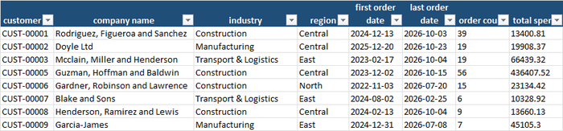
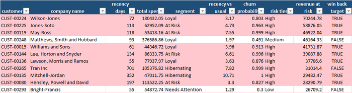
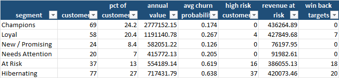
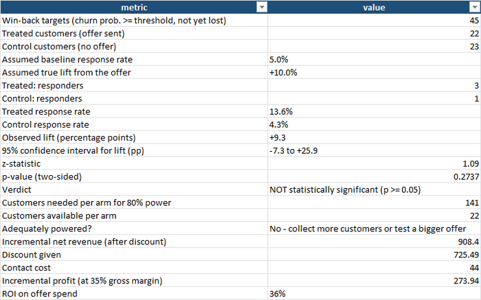

Ask the owner of a small B2B company which customers they are worried about and the
answer is usually a name or two — the one who complained last month, the one whose
buyer left. Ask which customers have quietly stopped ordering as often as they used to,
how much revenue that represents, and whether the last "we miss you" discount actually
brought anyone back, and the conversation usually ends with a shrug: "We only notice
when they're gone."

That is the expensive moment to notice. Winning a new customer typically costs several
times more than keeping an existing one, and a customer who has been silent for a year is
rarely coming back at any price. The useful moment is much earlier: when a customer who
used to order every three weeks hasn't ordered for ten.

This blog keeps returning to one idea: replace gut feel with a number. The
[customer segmentation](/2026/08/09/how-can-companies-profile-and-segment-their-customers/)
post asked *who are our customers?* using recency, frequency and spend; the
[lead conversion](/2026/07/22/lead-conversion-analytics-for-small-companies/) post
measured how many prospects become customers; the
[A/B testing](/2026/10/23/did-that-promotion-actually-work-ab-testing-for-small-businesses/)
post asked whether a promotion really worked. This post links all three: *which customers
are slipping away, how much revenue is at stake, and is it worth trying to win them
back?* The method is **churn-risk scoring** — measuring how overdue each customer is
against their *own* ordering rhythm — followed by a **controlled win-back test**.

For a small or medium-sized company this matters because the customer base is small and
lumpy. Losing three of your top twenty accounts can be a bad year. You do not have a data
science team and you do not need one: every figure in this post comes from a customer
list with three columns that your invoicing system already holds — when the customer
first ordered, when they last ordered, and how many orders and how much money in
between.

## What churn-risk scoring actually gives you

| Benefit | Why it matters for an SME |
|---|---|
| **An early-warning list** | Customers are ranked by how overdue they are *relative to their own habit*. A monthly buyer who has been silent for 90 days is a red flag; a twice-a-year buyer silent for 90 days is perfectly normal. |
| **Revenue at risk, in euros** | Each customer's chance of leaving multiplied by their yearly value. It turns "we have some at-risk accounts" into "€1.8 million of annual revenue is exposed, and €727,000 of it sits in 57 accounts". |
| **A priority order for the account managers** | There is never time to call everyone. The list says who to call first by money at stake, not by who shouts loudest. |
| **A way to catch the customer RFM calls "Loyal"** | The usual recency-frequency-spend grouping labels a big, frequent customer "Loyal" even when they have started to slow down. Measuring against their own rhythm exposes it. |
| **A test before the discount goes to everybody** | The win-back offer goes to half of the at-risk list and not to the other half, and the difference is measured, with a confidence interval, rather than assumed. |
| **The honest cost of the offer** | The discount given, the contact cost and the margin on the extra sales, so the return is a percentage, not a feeling. |
| **Bad data never reaches the score** | A validation step rejects negative spend, impossible dates, zero orders, blanks and duplicates before anything is scored. |

## A practical example, using this repo's own results

This repository — **[Churn-prediction-for-smes](https://github.com/MattProtopapas/Churn-prediction-for-smes)**
— ships with a full worked example. The scenario is a fictitious B2B supplier with **300
customers** across industries (construction, manufacturing, logistics, retail, hospitality,
bakery and food, professional services, wholesale) and regions. Customers are generated
from four behaviour groups — active, slowing, lapsing, lost — so there is a real signal to
find. For each customer the data holds the first order date, the last order date, the
number of orders and the total spend.

The raw file has **301 rows**; the validator rejected **16** (5.3%): four with a blank
industry, three with a date that isn't a date, one where the last order is *before* the
first, three with zero or negative spend, four with zero orders, and a duplicate ID.
That left **285 customers** — which is also a business lesson: 15 real customers
disappeared from the analysis because of data problems, and a customer who is missing
from the list cannot be saved.



## How a customer is scored

Three simple ideas, all in the workbook:

1. **RFM scores.** Recency (days since the last order), Frequency (number of orders) and
   Monetary value (total spend) are each scored 1 to 5 by quintile, 5 being best. The
   combination places each customer in a segment — Champions, Loyal, New / Promising,
   Needs Attention, At Risk, Hibernating.
2. **How overdue are they?** For each customer: `recency ÷ their usual days between
   orders`. A customer who normally orders every 22 days and has been silent for 72 is at
   **3.2×** their usual interval.
3. **Churn probability.** A simple, transparent curve of that ratio: a customer exactly
   **twice** as overdue as normal is a coin flip (50%); four times overdue is about 92%;
   one ordering right on their usual rhythm scores about 23%, and one who has just ordered
   scores lower still.

Revenue at risk is then the churn probability multiplied by the customer's annualised
spend. The **Customer Scores** tab lists every customer, sorted by it:



The top of that list is the most useful page in the workbook, and the top row is a
surprise. **Wilson-Jones**, a transport and logistics customer, is classed **Loyal** — high
frequency (31 orders) and high spend (€180,000). But it normally orders every **22.7
days** and has been silent for **72**. The ratio is 3.2×, the churn probability **80%**,
and it holds **€87,000 of annual value** — **€70,000 of revenue at risk**, the largest on
the list. A pure RFM view would have said *Loyal, no action needed*. The second row,
**Jones-Soto**, a wholesaler, is **4.7×** overdue with a **96%** churn probability and
€59,000 at risk. Number three, **May-Ross**, is **7.6×** overdue.

The **top ten accounts hold €430,000 of revenue at risk, 23% of the total; the top twenty
hold €663,000, 36%.** That is a call list a small team can work through in a week.

## Where the risk is

The **Segment Summary** tab adds the picture by group:



Of **285 customers**, worth **€6.24 million a year**, the workbook puts **€1.84 million
(29%) at risk** — but that total hides two very different problems:

- **At Risk and Hibernating customers** (114 customers, 40% of the list) carry
  **€806,000** of revenue at risk, with average churn probabilities around **62–64%**.
  These are customers who have slowed or stopped. They contain **53 of the 57 high-risk
  accounts**.
- **Champions** carry **€436,000** of "risk" despite **none** being high-risk — an
  average churn probability of 17% spread across a €2.8 million base. It is not that any
  one Champion is leaving; it is that concentration makes even a small probability
  expensive. Looking at it the other way, Champions are 24% of customers and 45% of the
  value, so a gentle, regular touch with them is worth more than a discount for anyone.
- **Loyal customers** hide the surprise: **four high-risk accounts** and **€428,000**
  of revenue at risk. This is where the early-warning ratio earns its keep.

There is a threshold effect worth knowing. The tool targets customers above **50%** churn
probability. **Matthews, Smith and Hubbard** — a manufacturer worth €94,000 a year, with
a €46,000 revenue at risk — sits at **49.1%** and is *not* on the target list. A cut-off
is a convenience, not a law; the top of the revenue-at-risk list deserves attention
whichever side of the line they fall.

## Is it worth winning them back?

**45 customers** qualify as win-back targets: churn probability of 50% or more, and still
within a year of their last order (the **27 who have been silent over a year** are
treated as already lost). Between them they hold **€839,000 of annual value**. The test
splits them at random: **22 get the offer, 23 do not**.



In this demo the responses are **simulated** from an assumed 5% baseline response rate
and a 10-point lift from the offer — in real life you run the campaign and type in what
actually happened. The result is the honest kind of messy:

- **3 of 22** treated customers responded (13.6%) against **1 of 23** in the control
  (4.3%): an observed lift of **+9.3 percentage points**.
- The 95% confidence interval runs from **−7.3 to +25.9 points**, the p-value is
  **0.27**, and the verdict is **not statistically significant**. The data are
  consistent with the offer working very well, doing nothing, or even backfiring.
- To detect a lift of this size reliably the test needs about **141 customers per
  group**. This demo has **22**. It is **underpowered** by a factor of six.

On the money: the offer brought in about **€908 of net revenue**, cost **€725 of
discount and €44 of contacts**, and — at a 35% gross margin — made **€274 of profit**,
an ROI of about **36%**. A positive number on a tiny sample. Nobody should roll that out
on the back of four responses, and the workbook says so in plain language: collect more
customers, test a bigger offer, or run the test over several campaigns.

## The business impact, in real numbers

Put a cost on what the workbook found:

1. **€1.84 million of €6.24 million in annual revenue is exposed** — 29% of the base —
   and €727,000 of it is concentrated in just 57 customers.
2. **The twenty biggest accounts at risk hold 36% of that exposure.** A two-person team
   can ring twenty customers in a week.
3. **RFM alone would have missed the most valuable slipping customer.** The Loyal label
   hid a €70,000 problem.
4. **Targeting works only if the list is right.** Fifteen customers dropped out of the
   file because of bad data; a customer with a missing industry is still a customer.
5. **The win-back result is a hypothesis, not a verdict.** A 36% ROI on 22 customers is
   interesting and unproven. The sample size check is the most valuable part of the
   answer: you need about 141 per group, or a bigger effect, to know.
6. **The cheap actions are the ones to try first.** Before any discount, a phone call
   from the account owner to the top ten costs nothing but time and does not teach
   customers to wait for a 10% offer.

## What to actually do with this, this week

1. **Export one row per customer:** first order date, last order date, number of orders,
   total spend, industry and region. Your invoicing system already holds it.
2. **Run the scoring and sort by revenue at risk, not by probability.** A 95% chance on a
   €2,000 customer matters less than a 60% chance on a €60,000 one.
3. **Read the top twenty with the account owners.** For each one, ask what is
   happening before looking at a number: a lost buyer, a competitor, a seasonal gap? The
   score finds the question; the account owner has the answer.
4. **Pick the offer deliberately.** A discount on a customer who would have ordered anyway
   is a pure cost — see the [pricing](/2026/10/12/how-should-a-small-company-set-its-prices/)
   post for the break-even arithmetic.
5. **Always hold back a control group.** Even 20 customers who don't get the offer
   are the only way to tell whether the offer worked.
6. **Re-score monthly.** Churn risk is a rhythm measure; it changes as soon as an order
   arrives.

## Try it yourself: a demo you can run in minutes

To make this concrete, **[Churn-prediction-for-smes](https://github.com/MattProtopapas/Churn-prediction-for-smes)**
is a small, self-contained, open-source Python pipeline. It:

1. Generates a fake B2B customer list in four behaviour groups, with a configurable share
   of deliberately corrupted rows.
2. Validates every row against a strict schema — including that the last order cannot
   precede the first — drops duplicates and writes a rejection report with a reason for
   every dropped row.
3. Scores every customer, runs the win-back test and writes it all into a **4-tab Excel
   workbook**.

### Downloading the code (no Git experience needed)

You don't need to know Git or the command line to get the code onto your computer:

1. Go to the repository: **[github.com/MattProtopapas/Churn-prediction-for-smes](https://github.com/MattProtopapas/Churn-prediction-for-smes)**
2. Click the green **`<> Code`** button near the top of the page.
3. Click **"Download ZIP"** in the dropdown.
4. Right-click the downloaded ZIP and choose **"Extract All..."** to unzip it into a
   regular folder.
5. Open that folder — that's the project. Ask your AI tool of choice (I used Claude) to
   set up a Python environment and install the dependencies listed in
   `requirements.txt` — no coding experience required to get it running.

If you're comfortable with Git,
`git clone https://github.com/MattProtopapas/Churn-prediction-for-smes.git` does the
same thing in one step.

### Running the demo

The repository includes a full `README.md`, but the short version, from PowerShell
(requires Python 3.10+; no machine-learning library is needed):

```powershell
python -m venv .venv
.\.venv\Scripts\Activate.ps1
pip install -r requirements.txt

python generate_data.py --count 300 --error-rate 0.05 --seed 42 --as-of 2026-10-27   # step 1: fake customers
python validate_data.py                                                              # step 2: schema checks, rejection report
python analyze_churn.py                                                              # step 3: scoring + win-back test -> Excel
```

Then open `output/churn_analysis.xlsx`. With `--seed 42` and `--as-of 2026-10-27` you'll get
exactly the numbers quoted in this post (recency is measured against "today", so the
fixed date keeps the figures the same whenever you run it); the workbook committed to the
repository's `output/` folder was produced the same way, so you can also just browse it
on GitHub without running anything.

On the analysis side, `--risk-threshold` sets the churn probability above which a customer
is targeted, `--lost-after-days` how long a silence counts as already lost, and
`--baseline-response`, `--lift`, `--discount-pct`, `--contact-cost` and `--gross-margin`
set the assumptions behind the win-back test. Try `--lift 0.20` for a stronger offer,
or a different `--seed`, and watch how much the verdict changes with only 45 customers.

Every input and output path is defined in one place in `churn_common.py`, so once you're
comfortable with the demo you can drop your own customer export — one row per customer
with the first and last order date, order count, total spend, industry and region —
into `data/`, skip `generate_data.py` entirely, and run `validate_data.py` and
`analyze_churn.py` straight on your own customers.

> **Note:** the sample data shipped with this repo is synthetic and randomly generated,
> and this project is intended for educational and demonstration purposes only — see the
> repository's
> [Disclaimer & EULA](https://github.com/MattProtopapas/Churn-prediction-for-smes/blob/main/DISCLAIMER.md)
> for details. It's a starting point for understanding churn risk and win-back testing,
> not a CRM.

## Understanding the results

The workbook — `output/churn_analysis.xlsx` — has four tabs.

**The verdict.** *Win-back Test* — treated and control responses, observed lift, confidence
interval, p-value, the power check (customers needed per group) and the ROI of the offer.
*Segment Summary* — the picture by RFM segment.

**The call list.** *Customer Scores* — every customer with R, F and M scores, segment, how
overdue they are, churn probability, risk tier, annual value and revenue at risk
(high-risk rows highlighted), sorted by money at stake.

**The input.** *Input Data* is the validated customer file exactly as the scoring read it.
Alongside it, `data/validation_report.txt` lists every rejected row and why.

## The limits worth keeping in mind

Churn scoring, like every tool covered on this blog, is genuinely useful within real
limits:

- **The probability is a heuristic, not a fitted model.** It is a transparent curve of how
  overdue a customer is, chosen to be explainable, not tuned on your history. With real
  records of who actually left, a logistic regression or boosted trees would do better —
  and the function is deliberately a single place in the code to replace.
- **Overdue is not the same as leaving.** A customer who orders in bursts, or whose
  project has simply ended, scores as high risk. Talk to the account owner before acting.
- **Annual value is annualised from history.** A customer with five orders worth
  €55,000 in a few months may look more valuable than they are. Check the extremes by
  hand.
- **The win-back responses in the demo are simulated.** They are drawn from the baseline
  and lift you set. Never quote that ROI; run the real campaign with a real control group.
- **Small samples decide little.** 22 versus 23 customers cannot separate a good offer
  from luck. That is not a reason not to test — it is a reason to run the test over
  several campaigns until the numbers are big enough.
- **Fifteen customers vanished into the rejection report.** Validation catches them; it
  cannot repair them.

None of that diminishes the core value. The customer list already exists. The arithmetic
is a ratio and a simple curve, and it runs in a spreadsheet. What churn scoring changes is
not that you know which customers matter, but that you find out **before** they have gone
— and, when you do try to win them back, that you know whether it worked.
