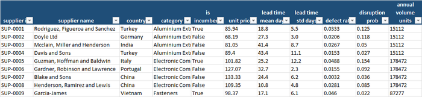
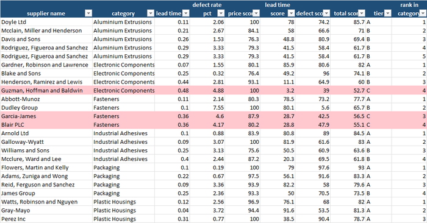
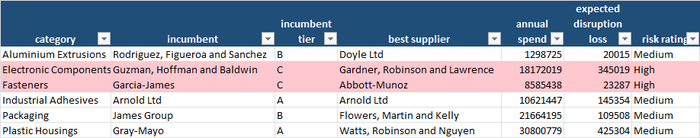
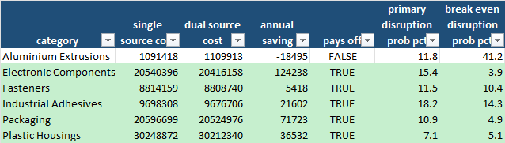

Ask the owner of a small manufacturing or distribution company which supplier they would
trust with a critical part and the answer is usually the one who has been around longest,
or the one whose sales rep answers the phone. Ask which supplier is really the cheapest
once you count the defective units, the late deliveries and the extra stock you hold to
cover for them, and whether you would be in trouble if your biggest one had a bad month,
and the answer slows down: "We've never really had a problem."

That is the dangerous sentence. A supplier problem is a rare event with a large price tag,
and the businesses it hurts most are the ones that never planned for it: a single source
for a part that makes up half the product, a quoted lead time that is an average and not
a promise, and a purchase price that looks lowest on the invoice and is highest in the
warehouse.

This blog keeps returning to one idea: replace gut feel with a number. The
[OTIF](/2026/09/07/are-your-orders-arriving-on-time-and-in-full/) post asked whether
*your* deliveries to *customers* arrive on time and in full; this post is its inbound
mirror — **which of your suppliers can you trust?** The
[inventory control](/2026/07/27/inventory-control-for-Small-and-Medium-companies/) post
showed that unpredictable lead times force you to hold more safety stock, and the
[quality control](/2026/08/29/how-can-a-small-manufacturer-keep-quality-under-control/)
post showed what defects cost inside your own walls. Here the same ideas are applied to
the companies you buy from, using three tools: a **weighted supplier scorecard**, a
**category risk rating**, and the **economics of dual-sourcing**.

For a small or medium-sized company this matters because you rarely have the purchasing
muscle to dictate terms, and you rarely have a spare supplier waiting. The goal is not to
audit everybody. It is to know which two or three categories could hurt you, and whether
a modest second source would pay for itself.

## What a supplier scorecard and risk analysis actually gives you

| Benefit | Why it matters for an SME |
|---|---|
| **One score per supplier, not a gut feeling** | Price, delivery predictability and quality are each scored 0–100 and weighted (40/30/30 by default, changeable). Every supplier gets a number and a tier: A preferred, B approved, C watch list. |
| **Reliability is priced in** | The lead-time score uses *variability*, not the average: a supplier who always takes 30 days is better for planning than one who takes 20 days or 45. Variability is what forces you to hold extra stock. |
| **The true cost of a cheap price** | The scorecard shows an effective unit cost that adds the cost of defects. A supplier that looks 20% cheaper on price can turn out only 11% cheaper once the faulty units are counted. |
| **A map of where you are exposed** | Every purchased category gets a High / Medium / Low risk rating that compares your current supplier with the best alternative, and puts a euro figure on the expected yearly loss from disruption. |
| **A calculation for "should we have a second supplier?"** | Dual-sourcing is compared with single-sourcing on the total annual cost: purchase price, defects, safety stock, expected disruption loss and the yearly cost of managing a second supplier. |
| **A break-even probability** | The yearly chance of an outage above which a second source pays for itself, per category — a number you can hold up against your own experience of how often things go wrong. |
| **Bad data never reaches the scorecard** | A validation step rejects negative prices, out-of-range rates, blanks and duplicate IDs before scoring. |

## A practical example, using this repo's own results

This repository — **[supplier-risk-analysis](https://github.com/MattProtopapas/supplier-risk-analysis)**
— ships with a full worked example. The scenario is a fictitious manufacturer buying in
**six categories** — aluminium extrusions, electronic components, fasteners, industrial
adhesives, packaging and plastic housings — each from three to five qualified suppliers in
different countries. For each supplier the data holds the unit price, the average lead
time and its standard deviation, the defect rate, the yearly probability of a major
disruption, the annual volume bought and whether it is the current (incumbent) supplier.
Cheaper suppliers are generated slightly less reliable on average, so price and
reliability genuinely trade off.

The raw file has **25 rows** and the validator rejected **1**: a plastic-housings
supplier with a defect rate of 1.8 — apparently 1.8% typed as 180%. That leaves **24
suppliers**. One honest caveat about the cleaning: the generator's deliberate duplicate
is a copy of an aluminium supplier under a *reused* ID, and because the genuine record
carrying that ID had already been rejected, the copy was accepted. As a result the same
supplier appears twice in the aluminium category. Two lessons: a validation step catches
most problems and not all, and a supplier list with the same company twice is exactly
the kind of thing a quick read of the scorecard exposes.



## Scoring suppliers: price is only one third of the story

The **Supplier Scorecard** tab ranks every supplier within its category:



The scores are simple, and worth spelling out:

- **Price score** = 100 × the cheapest price in the category ÷ this supplier's price.
- **Lead-time score** = 100 × (1 − the supplier's lead-time variability ÷ 50%), where
  variability is the standard deviation divided by the average lead time.
- **Defect score** = 100 × (1 − defect rate ÷ 8%), floored at zero.

Eleven suppliers land in tier **A** (75 or above), ten in **B** and three in **C**. The
tier-C suppliers are the interesting rows:

- **Guzman, Hoffman and Baldwin** (electronic components, Italy) has the *best* price in
  its category — a price score of 100 — and the worst reliability. Its lead times vary
  by 48% of their average (lead-time score of **3**), its defect rate is **4.9%** (defect
  score **39**), and it also has the second-highest yearly disruption probability in the data,
  **15.4%**. Total score **52.7**, last of four, tier C — and it is the *incumbent*, for
  a category on which this business spends about **€18 million** a year.
- **Dudley Group** (fasteners, Vietnam) is the cheapest in its category, at €86.49 a unit —
  20% below the €107.70 of the top-ranked supplier — but with a **7.6%** defect rate.
  Counting defects at twice the unit price, its *effective* cost is **€99.55**, and the
  gap to the leader shrinks to 11%. It is still cheaper, but the saving is about half what
  the price list suggested.
- **Henderson, Ramirez and Lewis** (electronic components, China) is the second-cheapest on
  price, at 93 out of 100, but its lead-time variability scores **11**: an average lead
  time of just 11 days that swings by almost half of itself from one order to the next.

The point of the weights is that they are *yours*. A just-in-time assembler might put 50%
on lead-time variability and 20% on price; a commodity buyer the opposite. The three
command-line weights (`--weight-price`, `--weight-lead-time`, `--weight-defects`) are the
place to put your own priorities and see how the ranking moves.

## Where you are exposed

The **Category Risk** tab compares the incumbent with the best alternative in each
category and rates the exposure:



Two categories are rated **High**. **Electronic components** is the headline: the
incumbent scores **52.7** against **82.0** for Gardner, Robinson and Lawrence (a 29-point
gap), the category carries **€18.2 million** of spend, and the expected yearly loss from
disruption is about **€345,000**. **Fasteners** is rated High for a different reason: the
incumbent (Garcia-James) is a tier-C supplier scoring **56.5** against **77.7** for the
best alternative — a 21-point gap — even though its own disruption probability is a
modest 2.2% and the expected loss only **€23,000**.

Contrast that with **plastic housings**, which carries the largest spend (**€30.8
million**) and the biggest expected disruption loss (**€425,000**) but is rated Medium and
"maintain": the incumbent is tier A and scores 81.3, within a point of the best
alternative. Risk is not the same as size. It is size multiplied by how far your supplier
is from the alternatives. And in **packaging** the incumbent, James Group, is only a
tier B but ranks **last of four** — a 20-point gap to the best — which the tool flags as
"review".

## Should we have a second supplier?

The **Dual-Sourcing** tab is where the decision gets a price. For each category it takes
the lowest-total-cost supplier as a single-source baseline, tries every other supplier
as a partner, and tests volume splits from 50/50 to 95/5. Cost in each case is the
purchase price, the cost of defects, the extra safety stock the lead-time variability
requires, the expected disruption loss, and a **€15,000 yearly cost** for qualifying and
managing a second supplier:



The result is clear. In **five of six categories**, splitting the volume pays — about
**€260,000 a year in total** — and in one, aluminium, it does not:

| Category | Annual saving from dual-sourcing | Yearly outage chance of the main supplier | Break-even outage chance |
|---|---|---|---|
| Electronic Components | **€124,238** | 15.4% | **3.9%** |
| Packaging | €71,723 | 10.9% | 4.9% |
| Plastic Housings | €36,532 | 7.1% | 5.1% |
| Industrial Adhesives | €21,602 | 18.2% | 14.3% |
| Fasteners | €5,418 | 11.5% | 10.4% |
| Aluminium Extrusions | −€18,495 | 11.8% | 41.2% |

The right-hand columns are the useful ones. In **electronic components**, a second source
pays for itself if the main supplier has even a **4%** chance of a serious outage in a
year; this one is at **15%**, nearly four times the threshold. Fasteners is the
opposite: the gap is thin (11.5% against 10.4%) and the saving is only about €5,000, so
whether to bother is a judgement call. **Aluminium** says *stay single-source*: it is a
small category (€1.3 million), the €15,000 cost of managing a second supplier is too large
a share of it, and the disruption probability would need to be **41%** for it to pay.

In every category dual-sourcing roughly **halves the expected disruption loss** — in
electronics, from about €345,000 to €184,000. That is what you are really buying: not a
lower price but a smaller worst case.

One subtlety worth understanding. The dual-sourcing analysis and the scorecard answer
*different* questions. The scorecard says Gardner is the better supplier of electronic
components; the cost model says Guzman, the cheapest even after pricing defects, stock
and disruption, remains the better *primary* supplier, with **5% of volume** going to a
backup. Neither is wrong. The scorecard weights reliability the way you chose; the cost
model prices what it can in euros. Where they disagree is exactly where the buyer's
judgement is worth the most.

## The business impact, in real numbers

Put a cost on what the workbook found:

1. **Two categories are rated High risk,** and both have an incumbent in the watch list
   tier, with more than 20 points of score between them and the best alternative.
2. **Electronic components alone carries about €345,000 of expected yearly disruption
   loss** — more than aluminium, fasteners, adhesives and packaging put together
   (€298,000).
3. **Dual-sourcing pays in five of six categories,** by roughly €260,000 a year on about
   €91 million of spend — a small percentage, but it comes almost entirely from *reducing a
   tail risk*, not from paying less.
4. **The cheapest price is not the cheapest supplier.** Dudley's €86.49 becomes €99.55 once
   its 7.6% defect rate is counted, halving its price advantage.
5. **Break-even probabilities turn arguments into data.** If you think your main
   supplier's outage chance is above 4%, a second source of electronic components is
   justified; the workbook says so in one line.
6. **The data-quality dividend.** A supplier with a 180% defect rate was rejected — and a
   duplicated supplier slipped through, which is why the scorecard needs a read.

## What to actually do with this, this week

1. **List your suppliers by category** with price, average and variation of lead time,
   defect or return rate, and how often they have failed you. Purchasing and goods-in
   records already contain all of it.
2. **Set the weights deliberately.** What matters most to *your* business: price,
   predictability or quality?
3. **Run the scorecard and read the tier C rows first.** Are they incumbents? Ask what
   it would cost to switch, and what it costs not to.
4. **Look at the category risk list for the single-sourced, high-spend lines.** Those
   are the ones where an outage hurts.
5. **Test one dual-sourcing case with your real fixed cost.** If a second supplier costs
   you more than €15,000 a year to qualify and manage, change the flag and re-run.
6. **Start with a small trial order from a second source.** The model's recommendation of
   5% of volume is about keeping a qualified supplier warm, not splitting the business.

## Try it yourself: a demo you can run in minutes

To make this concrete, **[supplier-risk-analysis](https://github.com/MattProtopapas/supplier-risk-analysis)**
is a small, self-contained, open-source Python pipeline. It:

1. Generates a fake supplier list across six categories, with a price/reliability
   trade-off and a configurable share of deliberately corrupted rows.
2. Validates every row against a strict schema, drops duplicates and writes a rejection
   report with a reason for every dropped row.
3. Builds the scorecard, rates category risk and evaluates dual-sourcing, writing it all
   into a **4-tab Excel workbook**.

### Downloading the code (no Git experience needed)

You don't need to know Git or the command line to get the code onto your computer:

1. Go to the repository: **[github.com/MattProtopapas/supplier-risk-analysis](https://github.com/MattProtopapas/supplier-risk-analysis)**
2. Click the green **`<> Code`** button near the top of the page.
3. Click **"Download ZIP"** in the dropdown.
4. Right-click the downloaded ZIP and choose **"Extract All..."** to unzip it into a
   regular folder.
5. Open that folder — that's the project. Ask your AI tool of choice (I used Claude) to
   set up a Python environment and install the dependencies listed in
   `requirements.txt` — no coding experience required to get it running.

If you're comfortable with Git,
`git clone https://github.com/MattProtopapas/supplier-risk-analysis.git` does the same
thing in one step.

### Running the demo

The repository includes a full `README.md`, but the short version, from PowerShell
(requires Python 3.10+; the statistics use only the standard library):

```powershell
python -m venv .venv
.\.venv\Scripts\Activate.ps1
pip install -r requirements.txt

python generate_data.py --categories 6 --suppliers-per-category 4 --error-rate 0.05 --seed 42   # step 1: fake suppliers
python validate_data.py                                                                        # step 2: schema checks, rejection report
python analyze_suppliers.py                                                                    # step 3: scorecard, risk, dual-sourcing -> Excel
```

Then open `output/supplier_analysis.xlsx`. With `--seed 42` you'll get exactly the
numbers quoted in this post; the workbook committed to the repository's `output/` folder
was produced the same way, so you can also just browse it on GitHub without running
anything.

The assumptions on the analysis step are the interesting part, because the
dual-sourcing result is very sensitive to them: `--defect-cost-multiplier` (cost of a
defective unit as a multiple of its price), `--holding-rate`, `--service-level`,
`--outage-days`, `--shortage-multiplier`, `--surge-capacity` (how much of a failed
supplier's volume the other can absorb) and `--dual-fixed-cost`. Try `--dual-fixed-cost
40000` and dual-sourcing pays in only **3 of 6** categories; try `--surge-capacity 0.2` — a
backup supplier that can absorb only a fifth of the volume — and it pays in only **1 of 6**.

Every input and output path is defined in one place in `supplier_common.py`, so once
you're comfortable with the demo you can drop your own supplier list — one row per
supplier with category, price, lead time mean and standard deviation, defect rate,
yearly disruption probability, annual volume and an incumbent flag — into `data/`, skip
`generate_data.py` entirely, and run `validate_data.py` and `analyze_suppliers.py`
straight on your own suppliers.

> **Note:** the sample data shipped with this repo is synthetic and randomly generated,
> and this project is intended for educational and demonstration purposes only — see the
> repository's
> [Disclaimer & EULA](https://github.com/MattProtopapas/supplier-risk-analysis/blob/main/DISCLAIMER.md)
> for details. It's a starting point for understanding supplier scoring and
> dual-sourcing economics, not a procurement system.

## Understanding the results

The workbook — `output/supplier_analysis.xlsx` — has four tabs.

**The verdict.** *Category Risk* — incumbent against the best alternative, expected
disruption loss, a High / Medium / Low rating and the recommended action (qualify a
backup, review the incumbent, mitigate, maintain). *Dual-Sourcing* — single against dual
annual cost, the saving, the break-even outage probability and a recommendation.

**The ranking.** *Supplier Scorecard* — component scores, total score, tier and rank per
supplier, tier C highlighted.

**The input.** *Input Data* is the validated supplier file exactly as the scoring read
it. Alongside it, `data/validation_report.txt` lists every rejected row and why.

## The limits worth keeping in mind

Supplier scoring, like every tool covered on this blog, is genuinely useful within real
limits:

- **The disruption inputs are assumptions.** The yearly probability of an outage, its
  length, the surge capacity of a backup and the shortage cost are *your* estimates, and
  the dual-sourcing result is very sensitive to them. Test several values.
- **The 95/5 split is the edge of the grid.** Every recommendation lands at the maximum
  tested share (95% to the primary). Read it as "qualify a second source and keep it
  warm", not as a precise split.
- **The scorecard sees three things.** It ignores payment terms, minimum orders, financial
  health, geopolitical risk and the relationship itself. They are often decisive.
- **Defect and disruption histories are short.** A supplier with one bad year is not
  necessarily a bad supplier. The more data behind each figure, the better.
- **Scoring is relative within a category.** A tier A in a poor category can be a tier C
  somewhere else.
- **A second source takes time.** Qualification, tooling, approvals and trust are not
  one-line costs. The €15,000 is a placeholder for yours.
- **Validation is not infallible.** One genuine supplier was rejected and one duplicate
  slipped through. Skim the scorecard for repeats.

None of that diminishes the core value. The purchase records already exist. The scoring is
a handful of ratios and the dual-sourcing arithmetic runs in a spreadsheet. What it
changes is not that you have suppliers you like, but that you know which ones you can
rely on, which categories are exposed, and what a modest backup would be worth —
**before** the bad month, when it can still be put in place.
