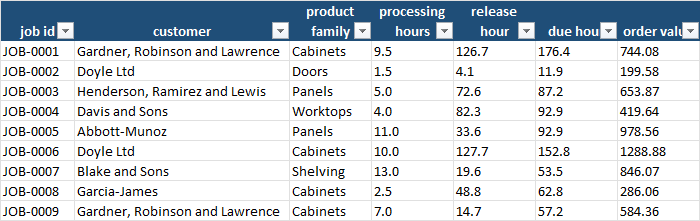
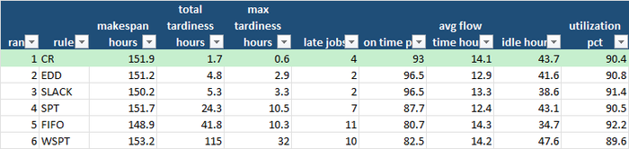
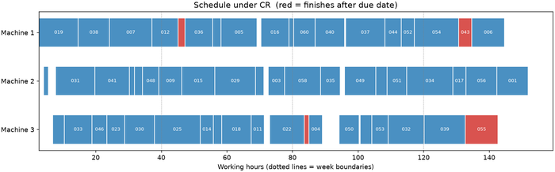
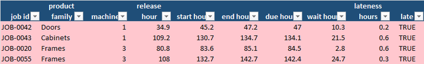
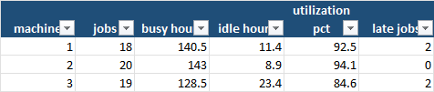
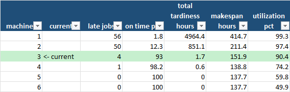
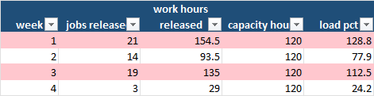

Ask the owner of a small workshop or production line how the day's jobs are sequenced and
the answer is usually one of two: "First come, first served — it's the fairest," or "Whoever
is shouting loudest goes next." Ask how many orders went out late last month, how much of
that lateness came from the order the jobs were run in rather than from not having enough
people or machines, and whether the new machine they are thinking about buying would
actually fix it, and the conversation usually ends with a shrug: "We're just busy."

Busy is not a diagnosis. A workshop running at 90% of its capacity can deliver almost
everything on time or miss one order in five, depending on nothing more than the *order*
in which the work is released to the machines. That is the cheapest improvement a small
manufacturer will ever find: no new equipment, no extra shift, just a rule.

This blog keeps returning to one idea: replace gut feel with a number. The
[staffing](/2026/10/18/how-many-staff-do-you-actually-need-on-a-saturday/) post asked how
many people a busy day needs; the
[demand forecasting](/2026/10/05/how-can-a-small-business-forecast-demand-for-next-month/)
post predicted how much work is coming; the
[OTIF](/2026/09/07/are-your-orders-arriving-on-time-and-in-full/) post measured how
often orders leave on time and complete. This post asks the question that sits between
them: *given the work that is coming and the machines or crews we have, in what order
should the jobs run — and do we have enough capacity?* The method is **scheduling with
dispatching rules**: simulate the shop floor under several simple ways of choosing the
next job, and compare them on the numbers that matter — late orders, lateness in hours,
and how busy the machines are.

For a small or medium-sized company this matters because there is rarely a planner with
specialist software. The schedule lives in a whiteboard, a spreadsheet and the foreman's
head. It does not take an expensive system to do better than that; it takes a handful of
rules, a list of jobs with due dates, and the willingness to look at the numbers.

## What scheduling and capacity analysis actually gives you

| Benefit | Why it matters for an SME |
|---|---|
| **More orders delivered on time, with the same machines** | Changing the rule that picks the next job moved this demo from 11 late jobs to 4, and total lateness from 42 hours to under 2. No investment. |
| **A fair comparison of the rules you could use** | Six standard rules — first come first served, shortest job first, earliest due date, least slack, critical ratio, highest value per hour — run on the same jobs, so the differences come from the rule, not luck. |
| **A trade-off made visible** | Different rules optimise different things: fewest late jobs, least total lateness, shortest queues. The table shows what each costs on the others, so you pick on purpose. |
| **An answer to "do we need another machine?"** | A capacity plan re-runs the schedule with one machine more, or one less, and shows what that does to lateness and utilization. |
| **Overloaded weeks spotted in advance** | Work released each week against the hours available. A 129% week is a quote-longer, work-overtime or outsource conversation to have before the orders are accepted. |
| **Idle time and balance per machine** | Which machine is overloaded, which waits for work, and where the late jobs actually land. |
| **A plan someone can follow** | Every job gets a machine, a start time and an end time, with late jobs highlighted, plus a Gantt chart. |
| **Bad data never reaches the schedule** | A validation step rejects impossible due dates, negative hours, blanks and duplicates before the simulation runs. |

## A practical example, using this repo's own results

This repository — **[Scheduling-capacity-planning](https://github.com/MattProtopapas/Scheduling-capacity-planning)**
— ships with a full worked example. The scenario is a fictitious small furniture
workshop with **three machines (or crews)**, each working **40 hours a week**, planning
**four weeks** of work. Each job has a customer, a product family (cabinets, doors,
frames, panels, shelving, worktops), a processing time in hours, a release time (when the
materials and drawings are ready), a due date and an order value. The generator sizes the
work to fill about **90% of the available hours**, so that the sequence genuinely
matters — a workshop with plenty of slack can run its jobs in any order.

The raw file has **61 rows**; the validator rejected **4**: one with processing hours that
were not a number, one with a due date *earlier than the earliest it could possibly be
finished* (impossible, so a typo), one with a blank customer and one duplicate job ID.
That leaves **57 jobs**, **412 hours of work**, **€41,629 of orders** from **10
customers**. Three of those four rejections were genuine jobs: a job that is dropped from
a schedule is a job that is promised and then forgotten.



## Which rule? It depends on what you are trying to protect

The tool runs the same 57 jobs under six dispatching rules. Whenever a machine becomes
free, the rule chooses the next job from those that are waiting:

| Rule | Picks the waiting job with… | In plain terms |
|---|---|---|
| **FIFO** | the earliest release time | first come, first served |
| **SPT** | the shortest processing time | quick jobs first |
| **EDD** | the earliest due date | most urgent first |
| **SLACK** | the least spare time (due − now − processing) | the one in most danger |
| **CR** | the lowest critical ratio (time to due ÷ processing time) | the most behind for its size |
| **WSPT** | the highest order value per hour | most money per hour first |

The **Rule Comparison** tab ranks them by total lateness:



The numbers tell a more interesting story than "use rule X":

- **FIFO**, the default most workshops use, finishes **11 jobs late**, with **41.8 hours**
  of total lateness, the worst single job 10.3 hours late, and only **80.7% of orders on
  time**.
- **CR** (critical ratio) reduces it to **4 late jobs and 1.7 hours of lateness**, with
  the worst job just 0.6 hours late, and **93% on time**. That is **96% less lateness**
  from a different rule, on the same machines.
- **EDD** and **SLACK** have the fewest late jobs of all — **2** each — but slightly more
  total lateness (4.8 and 5.3 hours). If "never miss a customer" matters more to you than
  "minimise the sum of delays", these are the rules to pick.
- **SPT** gets the shortest average time in the shop (12.4 hours) but lets the long jobs slip — seven
  late jobs and 24 hours of lateness. Great for a queue; hard on your biggest orders.
- **WSPT**, which puts the most valuable work first, is the worst of all: **115 hours** of
  lateness, with the worst job **32 hours** late. Chasing value per hour pushes the big,
  low-value-per-hour jobs to the back and ruins them. It is a good rule for choosing what
  to *accept*, and a bad one for choosing what to run next.

Notice also the **makespan** column: every rule finishes the whole batch in 149–153
hours, and every rule keeps the machines about 90% busy. *The sequence does not change how
much work gets done — it changes who gets served late.* That is exactly why it is
free: you are not buying capacity, just reshuffling who waits.

## What the best schedule looks like



The Gantt chart shows the winning schedule, with each block a job and the dotted lines
marking week boundaries. Late jobs are red — and there are only four of them, each
finishing by well under an hour late, at the point where the machine was already running
with no slack:



Taken together the four late jobs are worth **€1,514** of the **€41,629** order book,
**3.6%**, and the lateness on each is **0.2–0.6 hours**. It is the difference between
"the customer rang to chase it" and "nobody noticed". The **Machine Summary** shows
where the work lands:



Machine 2 is **94% busy** and has no late jobs; machine 1 is **92.5% busy** and carries two of the late jobs; machine 3 is the least
loaded at **85%**, yet carries the other two. A 10-point
spread in utilization is typical and a sign that a better balance might exist — which is
what the next question looks at.

## Do we need another machine? And is the problem the average or the peak?

The **Capacity Plan** tab re-runs the same jobs with different numbers of machines:



| Machines | Late jobs | On time | Total lateness | Utilization |
|---|---|---|---|---|
| 1 | 56 | 1.8% | 4,964 hours | 99.3% |
| 2 | 50 | 12.3% | 851 hours | 97.4% |
| **3 (today)** | **4** | **93%** | **1.7 hours** | **90.4%** |
| 4 | 1 | 98.2% | 0.6 hours | 74.2% |
| 5 | 0 | 100% | 0 | 59.8% |
| 6 | 0 | 100% | 0 | 49.9% |

This is the table to show whoever is asking for investment. Going from **two machines to
three** moves the workshop from "everything is late" to 93% on time — a transformation.
But going from **three to four** removes **three late jobs and about one hour of
lateness**, at the price of a fleet one-third bigger, dropping utilization from 90% to 74%. On
this evidence a fourth machine is hard to justify; an hour of overtime in a busy week is
the better lever. The fifth machine gets you to a clean 100% but would stand idle 40% of
the time.

One more warning, from the **Weekly Load** tab:



Across the four weeks the workshop has **480 hours** of capacity and **412 hours** of
work: **86%** — comfortable on average. But work is released in waves: week 1 brings
**154.5 hours (129% of capacity)**, week 3 brings **135 (113%)**, and week 4 brings only
**29 hours (24%)**. The schedule still works in this demo because jobs have different due
dates and work can run ahead of its week, and the rule is good at getting the urgent
jobs through. But it is the *peaks*, not the average, that make a workshop late — and the
two weeks that exceed 100% are where a customer will be told "three weeks", not
"two". The cheap fix is often upstream: agree delivery dates that respect the load,
rather than accepting everything for the same turnaround.

## The business impact, in real numbers

Put a cost on what the workbook found:

1. **The scheduling rule alone cut late jobs from 11 to 4 and lateness from 42 hours to
   under 2.** Same machines, same people, same orders.
2. **On-time delivery went from 81% to 93%** — and 96.5% with the earliest-due-date rule,
   if the count of late jobs is what customers notice.
3. **A fourth machine is not the answer.** Three machines on a good rule already deliver
   93% on time; the fourth removes about an hour of lateness.
4. **The real risk is the peak week.** An average load of 86% hid weeks at 129% and 113%.
5. **A value-first rule is a trap.** Running the highest-value jobs first produced the
   most lateness of all, 115 hours — a lesson for anyone sorting the queue by invoice.
6. **The data-quality dividend.** Three real jobs were dropped because of bad data. A
   missing job is a late job nobody scheduled.

## What to actually do with this, this week

1. **List the open jobs** with processing hours, the date they can start (materials
   ready), the date promised and the value. A spreadsheet export is enough.
2. **Decide what you are protecting.** Fewest late orders? Least total delay? Short
   queues? Fastest flow? The rule follows the answer.
3. **Run all six rules on a real week** and read the comparison table. If FIFO is the
   rule you use today, look at its late jobs and lateness first.
4. **Try the best rule for a fortnight** on a real week. Ask the foreman whether the
   order is practical, then compare the real lateness with last month's.
5. **Read the weekly load line before you quote.** If a week is above 100%, quote a
   longer lead time, schedule overtime or subcontract the job — before you accept it.
6. **Re-run the capacity plan before buying equipment.** The table says how much each
   extra machine really fixes.

## Try it yourself: a demo you can run in minutes

To make this concrete, **[Scheduling-capacity-planning](https://github.com/MattProtopapas/Scheduling-capacity-planning)**
is a small, self-contained, open-source Python pipeline. It:

1. Generates a fake set of production jobs sized to fill about 90% of your machine hours,
   with a configurable share of deliberately corrupted rows.
2. Validates every row against a strict schema — including that a job's due date must
   leave enough time to process it — drops duplicates and writes a rejection report with
   a reason for every dropped row.
3. Simulates all six rules, builds the capacity plan and weekly load and writes it all
   into a **7-tab Excel workbook** plus a Gantt chart.

### Downloading the code (no Git experience needed)

You don't need to know Git or the command line to get the code onto your computer:

1. Go to the repository: **[github.com/MattProtopapas/Scheduling-capacity-planning](https://github.com/MattProtopapas/Scheduling-capacity-planning)**
2. Click the green **`<> Code`** button near the top of the page.
3. Click **"Download ZIP"** in the dropdown.
4. Right-click the downloaded ZIP and choose **"Extract All..."** to unzip it into a
   regular folder.
5. Open that folder — that's the project. Ask your AI tool of choice (I used Claude) to
   set up a Python environment and install the dependencies listed in
   `requirements.txt` — no coding experience required to get it running.

If you're comfortable with Git,
`git clone https://github.com/MattProtopapas/Scheduling-capacity-planning.git` does the
same thing in one step.

### Running the demo

The repository includes a full `README.md`, but the short version, from PowerShell
(requires Python 3.10+; the simulation itself is plain standard-library Python —
`matplotlib` is only used for the Gantt chart):

```powershell
python -m venv .venv
.\.venv\Scripts\Activate.ps1
pip install -r requirements.txt

python generate_data.py --count 60 --error-rate 0.05 --seed 42   # step 1: fake jobs
python validate_data.py                                          # step 2: schema checks, rejection report
python analyze_schedule.py --machines 3                          # step 3: rules, capacity plan, Gantt -> Excel
```

Then open `output/schedule_analysis.xlsx`. With `--seed 42` you'll get exactly the numbers
quoted in this post; the workbook committed to the repository's `output/` folder was
produced the same way, so you can also just browse it on GitHub without running anything.

The options let you recreate your own situation: `generate_data.py --machines 2
--target-load 0.95` makes a heavier shop, `--weeks 8` plans a longer horizon, and
`analyze_schedule.py --max-machines 8` extends the capacity plan. Try a higher
`--target-load` and watch how the gap between the rules widens — and how, at a low load,
it all but disappears.

Every input and output path is defined in one place in `scheduling_common.py`, so once
you're comfortable with the demo you can drop your own order list — one row per job
with customer, product family, processing hours, release hour, due hour and order value
— into `data/`, skip `generate_data.py` entirely, and run `validate_data.py` and
`analyze_schedule.py` straight on your own orders.

> **Note:** the sample data shipped with this repo is synthetic and randomly generated,
> and this project is intended for educational and demonstration purposes only — see the
> repository's
> [Disclaimer & EULA](https://github.com/MattProtopapas/Scheduling-capacity-planning/blob/main/DISCLAIMER.md)
> for details. It's a starting point for understanding dispatching rules and capacity
> planning, not a production-planning system.

## Understanding the results

The workbook — `output/schedule_analysis.xlsx` — has seven tabs.

**The verdict.** *Rule Comparison* — the six rules ranked by total lateness, with the
best highlighted. *Capacity Plan* — lateness and utilization as you add or remove
machines. *Weekly Load* — work released against capacity, with weeks above 100% flagged.

**The plan.** *Best Schedule* — job by job: machine, start and end time, wait and
lateness, late jobs highlighted. *Machine Summary* — busy hours, idle hours and
utilization per machine. *Gantt* — the schedule as a chart, late jobs in red.

**The input.** *Input Data* is the validated job file exactly as the simulation read it.
Alongside it, `data/validation_report.txt` lists every rejected row and why.

## The limits worth keeping in mind

Scheduling, like every tool covered on this blog, is genuinely useful within real limits:

- **Machines are identical and jobs are not interrupted.** Real shops have machines with
  different skills, set-up times between product families, shift patterns and jobs that
  are paused for a rush order. Each one makes a real schedule harder than the model's.
- **Processing times are assumed known.** In real life they are estimates, and the
  estimates are optimistic. A schedule with 0.6 hours of lateness has no room for a
  machine that runs 5% slow — run it with your real overruns.
- **The best rule depends on your objective.** The workbook ranks by total lateness, and
  the winner would change if the goal were the fewest late jobs or the shortest queue.
  Choose the goal first.
- **Greedy rules are not optimal schedules.** They are fast, simple and easy to explain,
  which is why they are used on shop floors. A specialist solver could do better on a
  complex shop, but few SMEs would be able to run or explain it.
- **One scenario is one scenario.** Four weeks of jobs is a single draw. Run your own
  history through it before you trust the ranking.
- **Three real jobs were lost to bad data.** The validation step caught them; it cannot
  repair them.

None of that diminishes the core value. The orders and due dates already exist. The
rules are simple enough to explain to the foreman, and the simulation runs in a second.
What it changes is not that you have a schedule, but that you know **what the way you
sequence work costs you** — and, before you buy another machine, whether the answer is
equipment, overtime, or simply deciding in a different order what gets made next.
