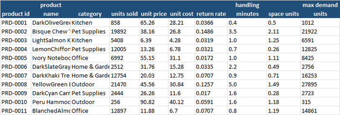
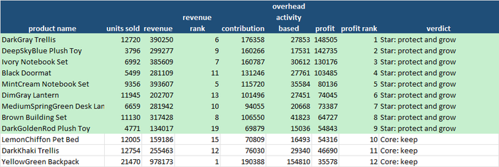
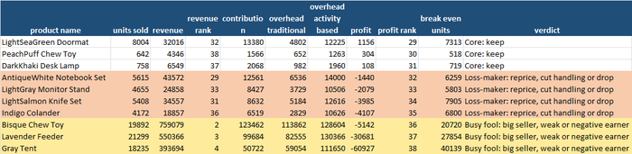
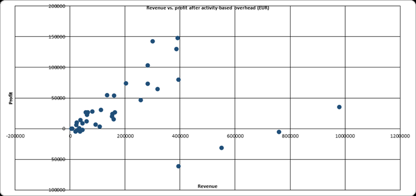
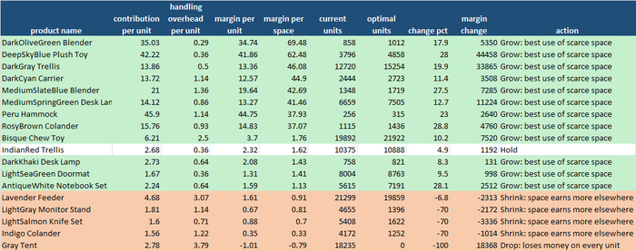
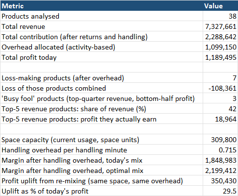

Ask the owner of a small retailer, wholesaler or webshop which product makes them the most
money and they will usually name the best seller — the one that fills the order book, the
one the sales team talks about, the one that has to be re-ordered every fortnight. Ask what
that product earns *after* the returns that come back, the minutes it takes to pick and pack,
and the shelf space it takes up, and the answer changes to: "Well, it must be doing fine —
look at the volume."

Volume is not profit. A product can sell thousands of units a year and still lose money on
every one of them, quietly, because the costs it causes are not on its line in the
accounts. They sit in the warehouse wage bill, the returns desk, the rent, and they are
shared out across everything as a flat percentage of sales — which is exactly the
arithmetic that makes a busy, awkward, low-margin product look as good as a quiet, easy,
high-margin one.

This blog keeps returning to one idea: replace gut feel with a number. The
[pricing](/2026/10/12/how-should-a-small-company-set-its-prices/) post asked what price to
charge; the [capital budgeting](/2026/08/08/how-can-companies-decide-which-capital-projects-to-fund/)
post asked which projects deserve money; the
[working capital](/2026/08/27/how-much-working-capital-should-be-tied-up-in-inventory/) post
asked how much stock to hold. This post asks the question underneath all three — **which of
your products actually make money?** — and answers it with four tools: **contribution per
unit** after returns and handling, **activity-based overhead**, the **break-even volume**,
and a small **product-mix optimization** that decides what to grow and what to cut when space
is the limit.

December is the right moment. Next year's ranges, re-orders and supplier contracts are being
decided now, and a product that loses money on every unit is cheapest to drop *before* the
next purchase order, not after.

## What a product profitability analysis actually gives you

| Benefit | Why it matters for an SME |
|---|---|
| **A profit figure per product, not a revenue figure** | Each product is charged with what it really costs: goods, returns that come back, handling labour, and its share of the overhead. Revenue rank and profit rank sit side by side. |
| **Overhead shared out by what causes it** | Instead of one percentage of sales, the overhead is split into simple pools — handling, space and general — each spread by its own driver. A bulky, fiddly product carries the cost it creates. |
| **"Busy fools" found by name** | Products in the top quarter by revenue and the bottom half by profit are flagged. They are the most dangerous items in a range because nobody questions them. |
| **A break-even volume** | How many units a product must sell to cover its overhead, and how far today's sales are above or below that line. |
| **A better mix for the same space** | With shelf or warehouse space as the limit, the tool works out which products to grow, hold, shrink or drop to earn the most from the space you already pay for. |
| **Bad data never reaches the numbers** | A validation step rejects negative prices, impossible return rates, blanks and duplicate IDs before anything is calculated. |

## A practical example, using this repo's own results

This repository — **[product-profitability-for-smes](https://github.com/MattProtopapas/product-profitability-for-smes)**
— ships with a full worked example. The scenario is a fictitious distributor of home,
kitchen, office, outdoor, pet and toy products. For each product the data holds the units
sold last year, the selling price, the purchase cost, the share of units returned, the
minutes of handling labour per unit (picking, packing, shipping), the space one unit takes
up, and a demand ceiling — the most the market would buy at today's price.

A few products are planted as "bestseller traps": big volume, thin margin, a high return
rate and awkward to handle — the kind of item every distributor has at least one of.

The raw file has **41 rows** and the validator rejected **3**: one product with a negative
price, one with a return rate above 100% (a percentage typed in the wrong place), and a
duplicate row reusing an existing product ID. That leaves **38 products** with **€7.33
million** of revenue between them.



## Step 1: what a unit really contributes

Gross margin — price minus purchase cost — is the number most owners know by heart. It is
also the number that flatters the wrong products, because it ignores two costs that grow
with every unit sold:

- **Returns.** A returned unit gives back its revenue, and the product comes back in a
  condition where only part of it can be resold. In this demo half the cost of a returned
  unit is recovered (`--salvage-rate 0.5`).
- **Handling.** Every unit takes minutes of labour to pick, pack and ship, and a returned
  unit is handled twice. The demo prices labour at **€22 an hour**.

So the contribution per unit is:

- net revenue = price × (1 − return rate)
- cost of goods = cost × (1 − return rate × resold share)
- handling = minutes ÷ 60 × labour rate × (1 + return rate)
- **contribution = net revenue − cost of goods − handling**

Take **Gray Tent**. On paper it sells for €21.59 and costs €14.80: a 31% gross margin, very
respectable. But 12.8% of tents come back, and each one takes 5.3 minutes to handle. After
returns and handling it contributes **€2.78 a unit** — about 40% of its €6.79 gross margin.

Across the whole range, the €7.33 million of revenue leaves **€2.29 million** of
contribution once returns and handling are counted.

## Step 2: sharing out the overhead by what causes it

The business also carries **€1.10 million** of overhead in this example — warehouse
supervision, the returns desk, rent, systems, management. The usual way to share it out is
a flat percentage of revenue: here 15%. That is simple, and it is wrong in a specific,
predictable direction: it under-charges products that are bulky and fiddly and over-charges
products that are compact and easy.

The tool uses three simple pools instead — a light version of **activity-based costing**:

| Pool | Share of overhead | Shared out by |
|---|---|---|
| Handling | 40% | total handling minutes (units × minutes per unit) |
| Space | 30% | total space used (units × space per unit) |
| General | 30% | revenue |

The pool shares are flags (`--handling-pool-share`, `--space-pool-share`), so you can set
them to match your own cost structure. Even this rough split moves the picture a lot. Gray
Tent carries **€59,054** of overhead under the flat-percentage method and **€111,650** under
the activity-based one — almost double — because it is bulky and slow to handle. The
compact, easy products move the other way: **DeepSkyBlue Plush Toy** goes from €44,891 to
**€17,531**.

## The result: the best sellers are not the best earners

The **Product Profitability** tab puts revenue rank and profit rank next to each other. The
top of the list is reassuring:



The most profitable product, **DarkGray Trellis**, is only sixth by revenue; the second,
**DeepSkyBlue Plush Toy**, is ninth by revenue and earns a **47.7%** profit margin — it is
expensive, rarely returned, and takes half a minute to pack. Nine products are flagged
**Star: protect and grow**.

The bottom of the list is where the money goes:



Three of the **four biggest products by revenue** are the three **least profitable products
in the range**:

| Product | Revenue | Revenue rank | Profit after overhead | Profit rank |
|---|---|---|---|---|
| Bisque Chew Toy | €759,079 | 2 | **−€5,142** | 36 |
| Lavender Feeder | €550,366 | 3 | **−€30,681** | 37 |
| Gray Tent | €393,694 | 4 | **−€60,927** | 38 |

Those are the **busy fools**: together they bring in **€1.7 million** of revenue — almost a
quarter of the business — and lose **€96,750**. Under the flat 15% overhead, two of the three
would look *profitable*: Bisque Chew Toy at +€9,600 and Lavender Feeder at +€17,129. That is
the whole point of the exercise. The traditional allocation does not just get the figure
wrong; it gets the *sign* wrong, and the owner keeps re-ordering a product that is losing
money.

Even the best seller is doing less than it seems. **YellowGreen Backpack** is the number one
product by revenue at **€978,173** — 13% of the business — and ranks twelfth by profit, with
a **3.6%** margin.

Put it all together and the picture is stark: the **top five products by revenue** bring in
**42%** of sales and earn **€18,964** of profit between them — about **1.6%** of the
business's €1.19 million total. The profit is being made in the middle of the range, by
products nobody talks about.

In total **seven products** lose money after overhead, costing **€108,361** a year: the three
busy fools and four small items (a notebook set, a monitor stand, a knife set and a
colander) that are cheap, slow to handle and take more space than they deserve.

Here is the same story as a picture — every product, revenue against profit:



Most products sit on a rising line: sell more, earn more. Four dots break away to the
right, and three of them are below zero. Those are the conversations to have this month.

## Break-even: how far from covering their costs?

The **break-even volume** is the overhead a product carries divided by its contribution per
unit — the number of units it must sell before it earns anything. The **margin of safety**
compares that with what it actually sells:

- **Bisque Chew Toy** needs **20,720** units and sells **19,892**: it is **4%** short. A
  modest fix — a small price rise, a cheaper pack, a lower return rate — would tip it over.
- **Lavender Feeder** needs **27,854** and sells **21,299**: **31%** short. That needs a real
  change, not a nudge.
- **Gray Tent** needs **40,139** units and sells **18,235**: it would have to more than double
  its volume to break even, and more volume of a product that loses money on every handled
  unit only makes things worse.

The break-even line turns "this product is disappointing" into a specific question with a
specific answer: how much more volume, how much higher a price, or how much less handling
would it take?

## Step 3: the best mix for the space you have

Cutting a product does not save its share of the rent; the warehouse is still there. What
it does is free *space*, and the useful question is what that space should hold instead.

The **Mix Optimization** tab answers it. It maximizes the total margin the range earns,
where the margin per unit is the contribution minus the overhead that really moves with
activity — the handling pool, which works out at about **€0.72 per handling minute**. Space
and general overhead stay fixed, because space is the limit itself. The constraint is simple:
use no more space than today. Each product can grow up to its demand ceiling, products with a
positive margin keep at least **30%** of today's volume (customers notice when things
disappear), and a product that loses money on every unit can be cut to zero.

With a single space constraint the best answer is found by a simple rule that is provably
optimal for this kind of problem: rank products by **margin per unit of space**, and fill the
space from the top of the list until each product hits its demand ceiling.



The ranking explains itself. **DarkOliveGreen Blender** earns **€69** per unit of space;
**Gray Tent** *loses* €0.79, because its €2.78 contribution does not cover the €3.79 of
handling overhead each unit causes. The verdicts follow:

- **Drop Gray Tent.** It loses money on every unit before any rent is counted. Dropping it
  is worth **€18,368** a year on its own, and frees about 23,000 units of space.
- **Shrink four products** — a monitor stand, a knife set and a colander down to the 30% floor,
  and **Lavender Feeder** by 7%.
- **Grow 29 products** towards their demand ceilings, starting with the ones that earn the
  most per unit of space.

The result: the same space, the same overhead, and **€350,430** more margin a year — about
**29%** more than today's €1.19 million profit.

There is a subtle lesson in **Bisque Chew Toy**. It loses money after overhead, yet the
optimizer *keeps* it and even grows it slightly. That is not a contradiction. Its €3.70
margin per unit is positive once only the handling overhead is charged; it loses money only
after its share of rent and general overhead, which would not disappear if it were dropped.
Cutting it would make the whole business *poorer*. The right move for Bisque is the
break-even one — fix the price, the pack or the returns — not the axe.

A warning in the other direction: an uplift of 29% is the ceiling of what re-mixing could
do, not a forecast. It assumes the demand ceilings are real and that customers who bought a
dropped product will buy something else from you. The direction of the answer is more robust
than its size.

## The business impact, in real numbers

Put a cost on what the workbook found:

1. **Three of the four best sellers lose money.** Bisque Chew Toy, Lavender Feeder and Gray
   Tent bring in €1.7 million and lose €96,750 between them.
2. **The flat overhead percentage hides it.** Under the usual 15%-of-sales allocation, two of
   the three would look profitable. Activity-based overhead nearly doubles Gray Tent's share.
3. **The top five products earn 1.6% of the profit.** They are 42% of revenue and €18,964 of
   a €1.19 million profit.
4. **Seven products lose €108,361 a year** after overhead.
5. **Gray Tent loses money on every unit.** Dropping it adds €18,368 a year and frees space.
6. **The same space could earn €350,430 more.** Growing the products that earn the most per
   unit of space and shrinking the rest is worth up to 29% of today's profit.
7. **Bisque Chew Toy is 4% from break-even.** A small fix, not a cut.
8. **The data-quality dividend.** A negative price, a 140% return rate and a duplicate ID were
   rejected before they could distort the ranking.

## What to actually do with this, this week

1. **Export last year's sales by product** — units, price, cost — and add the return rate
   from your returns log. All of it already exists.
2. **Estimate handling minutes per product.** Time ten picks of your top 20 products with a
   stopwatch; group the rest as small, medium or bulky. Rough is fine.
3. **Estimate space per unit.** Shelf metres, pallet positions or cubic metres — any
   consistent unit works.
4. **Split your overhead into three pools** — what grows with handling, what grows with
   space, and the rest — and run the analysis.
5. **Read the busy fools first.** For each one decide: raise the price, cut the handling,
   reduce returns, or let it go.
6. **Check the break-even list** for products just below the line: they need a nudge, not a
   cut.
7. **Use the mix tab to plan next year's buying,** starting with the products that earn the
   most per unit of space.

## Try it yourself: a demo you can run in minutes

To make this concrete, **[product-profitability-for-smes](https://github.com/MattProtopapas/product-profitability-for-smes)**
is a small, self-contained, open-source Python pipeline. It:

1. Generates a fake product range with realistic costs, returns, handling and space — plus a
   few planted bestseller traps — and a configurable share of deliberately corrupted rows.
2. Validates every row against a strict schema, drops duplicates and writes a rejection
   report with a reason for every dropped row.
3. Calculates contribution, activity-based overhead, profit, break-even volumes and the
   optimal mix, writing it all into a **4-tab Excel workbook**.

### Downloading the code (no Git experience needed)

You don't need to know Git or the command line to get the code onto your computer:

1. Go to the repository: **[github.com/MattProtopapas/product-profitability-for-smes](https://github.com/MattProtopapas/product-profitability-for-smes)**
2. Click the green **`<> Code`** button near the top of the page.
3. Click **"Download ZIP"** in the dropdown.
4. Right-click the downloaded ZIP and choose **"Extract All..."** to unzip it into a
   regular folder.
5. Open that folder — that's the project. Ask your AI tool of choice (I used Claude) to
   set up a Python environment and install the dependencies listed in
   `requirements.txt` — no coding experience required to get it running.

If you're comfortable with Git,
`git clone https://github.com/MattProtopapas/product-profitability-for-smes.git` does the
same thing in one step.

### Running the demo

The repository includes a full `README.md`, but the short version, from PowerShell
(requires Python 3.10+; no scientific libraries needed):

```powershell
python -m venv .venv
.\.venv\Scripts\Activate.ps1
pip install -r requirements.txt

python generate_data.py --products 40 --traps 5 --error-rate 0.05 --seed 42   # step 1: fake products
python validate_data.py                                                      # step 2: schema checks, rejection report
python analyze_products.py                                                   # step 3: profitability, break-even, mix -> Excel
```

Then open `output/product_profitability.xlsx`. With `--seed 42` you'll get exactly the
numbers quoted in this post; the workbook committed to the repository's `output/` folder was
produced the same way, so you can also just browse it on GitHub without running anything.

The assumptions on the analysis step are where your own business comes in:
`--labour-rate-per-hour`, `--salvage-rate` (how much of a returned unit you recover),
`--overhead-pct`, the two pool shares, `--min-share` (how much of a profitable product you
must keep) and `--capacity-pct` (try `1.1` to see what 10% more space would be worth).

Every input and output path is defined in one place in `product_common.py`, so once you're
comfortable with the demo you can drop your own product list — one row per product with
units, price, cost, return rate, handling minutes, space per unit and a demand ceiling — into
`data/`, skip `generate_data.py` entirely, and run `validate_data.py` and
`analyze_products.py` straight on your own range.

> **Note:** the sample data shipped with this repo is synthetic and randomly generated, and
> this project is intended for educational and demonstration purposes only — see the
> repository's
> [Disclaimer & EULA](https://github.com/MattProtopapas/product-profitability-for-smes/blob/main/DISCLAIMER.md)
> for details. It's a starting point for understanding product profitability, not an
> accounting system.

## Understanding the results

The workbook — `output/product_profitability.xlsx` — has four tabs.

**The headline.** *Summary* — revenue, contribution, overhead and profit; the number of
loss-makers and busy fools; what the top five products by revenue really earn; and the
profit uplift from re-mixing.



**The ranking.** *Product Profitability* — for every product, revenue and its rank,
contribution per unit and in total, overhead under both the flat and the activity-based
method, profit and its rank, the gap between the two ranks, the break-even volume, the margin
of safety and a verdict. Stars are green, busy fools amber, loss-makers red.

**The plan.** *Mix Optimization* — margin per unit and per unit of space, current and optimal
units, the change in margin and an action: grow, hold, shrink or drop.

**The input.** *Input Data* is the validated product file exactly as the analysis read it.
Alongside it, `data/validation_report.txt` lists every rejected row and why.

## The limits worth keeping in mind

Product profitability, like every tool covered on this blog, is genuinely useful within real
limits:

- **Overhead allocation is a model, not a fact.** The three pools are a sensible
  simplification; your real cost drivers may differ. Test different pool shares and see
  whether the busy fools stay busy fools — in this example they do.
- **Products are not independent.** A loss-making product may bring customers who buy
  profitable ones in the same order. The
  [market basket analysis](/2026/08/03/how-can-a-small-company-use-market-basket-analysis/)
  post shows how to check before you drop it.
- **Demand ceilings are estimates.** The mix optimization assumes you could sell more of the
  good products at today's price. If you couldn't, the uplift is smaller.
- **One constraint only.** The demo optimizes for space. If your real limit is labour,
  machine hours or working capital, the same logic applies with a different denominator.
- **Overhead is fixed in the short run.** Dropping a product does not cut the rent next
  month. The mix tab respects that; a spreadsheet that deletes the loss-makers and their
  overhead does not.
- **Returns and handling times move.** A product with a 15% return rate this year may have a
  fixable packaging problem. Fix first, judge after.

None of that diminishes the core value. The sales, cost and returns data already exist; the
handling and space estimates take an afternoon; the arithmetic is a few columns in a
spreadsheet. What it changes is not that you know your best sellers, but that you know your
best *earners* — and which of the products you are proudest of are quietly costing you
money, **before** next year's orders are placed.
