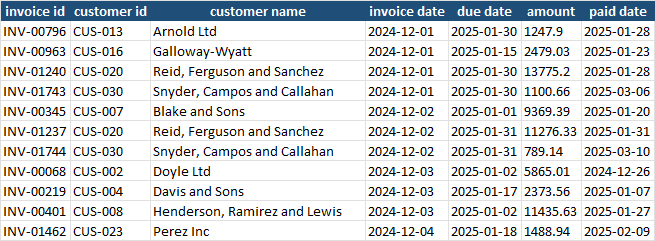
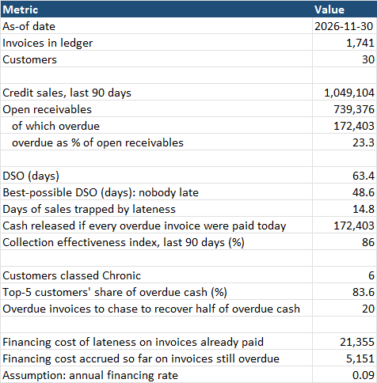
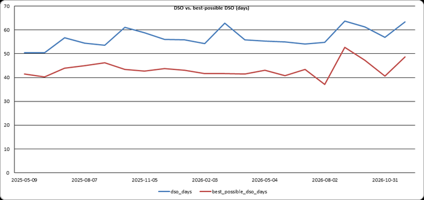
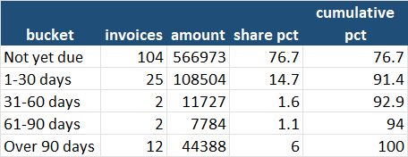
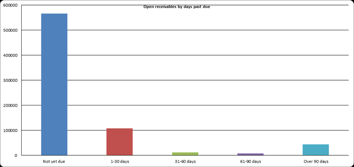
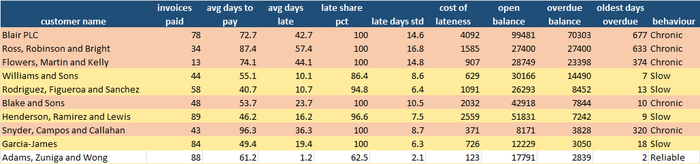
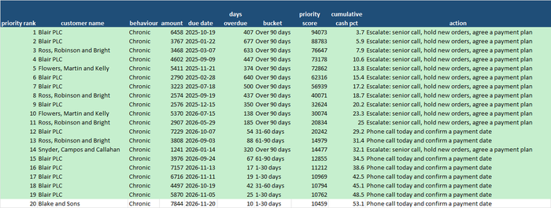

Ask the owner of a small business-to-business company how their customers pay and the
answer is nearly always the same: "Most of them pay fine. There are one or two slow ones."
Ask how many days of sales are sitting in unpaid invoices right now, how much of that is
overdue, which three customers account for most of it, and what the lateness costs in
interest or in the overdraft, and the answer becomes: "I'd have to ask the bookkeeper."

That gap matters most in December. Customers close their year by holding on to cash; your
own January brings rent, tax and supplier bills; and the invoices that slipped past their
due date in October are the ones that quietly become uncollectable by March. A sale is not
cash until the customer pays, and for many small companies the money owed *to* them is the
largest asset on the balance sheet after stock.

This blog keeps returning to one idea: replace gut feel with a number. The
[working capital](/2026/08/27/how-much-working-capital-should-be-tied-up-in-inventory/) post
looked at cash tied up in stock; the
[cash buffer](/2026/11/07/how-much-cash-does-a-small-business-need-to-avoid-running-short/)
post asked how much cash you need to avoid running short. This post looks at the other half
of working capital — **why is the cash from your sales arriving so late, and who should you
chase first?** — using five tools: **days sales outstanding (DSO)** and its **best-possible**
twin, an **ageing table**, the **collection effectiveness index**, **customer payment
profiles**, and a **prioritised dunning list**.

## What a receivables analysis actually gives you

| Benefit | Why it matters for an SME |
|---|---|
| **One number for how fast you get paid** | DSO converts the receivables balance into days of sales. It is the number the bank looks at, and it can be tracked every month. |
| **The part of it that is lateness** | Best-possible DSO counts only invoices that are not yet due. The gap between the two is the cash trapped purely by customers paying late — the part you can do something about. |
| **Where the money is stuck** | The ageing table groups open invoices by how far past due they are. An invoice 90 days overdue is a very different problem from one 9 days overdue. |
| **How well you are collecting** | The collection effectiveness index measures what share of the collectable cash was actually collected over the last quarter. |
| **Customers by behaviour, not by reputation** | Every customer's real payment history — average days late, share paid late, spread — and a class: reliable, slow or chronic. |
| **A list to start calling on Monday** | Every overdue invoice ranked by amount and age, with the cumulative share of overdue cash, so you can see how few calls recover most of it. |
| **A cost for lateness** | What late payment costs you in financing, invoice by invoice and customer by customer. |

## A practical example, using this repo's own results

This repository — **[receivables-collection-for-smes](https://github.com/MattProtopapas/receivables-collection-for-smes)**
— ships with a full worked example. The scenario is a fictitious wholesaler with **30
business customers** on 30-, 45- or 60-day terms, and two years of invoices up to
**30 November 2026**. Each row is one invoice: customer, invoice date, due date, amount, and
the date it was paid — blank if it is still open. Most customers pay roughly on time; some
are consistently slow; a few are chronic late payers whose invoices sometimes stay open for
good. That mix is typical.

The raw ledger has **1,796 rows** and the validator rejected **55** of them: invoices paid
before they were issued, due dates before invoice dates, impossible dates like 31 February,
negative amounts, missing customer names, and a duplicate invoice number. That leaves
**1,741 invoices** worth about **€4.3 million** of sales in the last twelve months.

Fifty-five bad rows in 1,800 is not unusual in a real ledger export. Every one of them would
distort a DSO figure, which is why the validation step comes first.



## The headline: 63 days to get paid, 15 of them avoidable

The **Summary** tab puts the whole position on one page:



The numbers to read first:

- **Open receivables: €739,376**, of which **€172,403 (23%)** is overdue.
- **DSO: 63.4 days.** On average a euro of sales takes about two months to come in.
- **Best-possible DSO: 48.6 days.** That is what DSO would be if every customer paid on the
  due date — the floor set by your own payment terms.
- **14.8 days of sales are trapped by lateness.** At about €11,700 of sales a day, that is
  roughly **€172,000** of cash that should already be in the bank.

That last figure is the most useful one in the workbook. A DSO of 63 by itself means little:
it could be good for a business on 60-day terms and terrible for one on 30. Splitting it into
*the part your terms create* and *the part your customers' lateness creates* tells you what a
collections effort could achieve. Here, it is about €172,000 — roughly two weeks of the
whole business's sales.

Two more numbers complete the picture. The **collection effectiveness index** for the last
90 days is **86%**: of all the cash that was collectable in the quarter, 86% was collected.
Above 80% is usually considered reasonable; the missing 14% is the part sliding into the
older buckets. And late payment has a price: at a **9%** financing rate, customers' lateness
on invoices already paid cost about **€21,355** over two years, and the invoices still
overdue have accrued another **€5,151** so far.

## The trend: worse than a year ago

DSO is a number to watch over time. The **DSO Trend** tab calculates it every 30 days:



The bottom line is the floor set by payment terms; it stays mostly between **40 and 48 days**
and jumps only when large invoices happen to fall due together. The top line is the real DSO. Eighteen months
ago it was **50 days**; now it is **63**. The gap between the lines — the lateness — has
roughly doubled over that time, from about 9 days to 15. Nothing in the terms changed; the
customers just got slower, and nobody noticed because each month was only a little worse than
the last.

## Where the money is stuck: the ageing table

The **Ageing** tab groups every open invoice by how far past due it is:





Three-quarters of the balance (**€566,973**) is not yet due — that is healthy, normal trade
credit. The overdue part splits into two very different problems:

- **1–30 days overdue: €108,504 across 25 invoices.** These are recent and still very likely
  to be paid. A reminder now costs nothing and stops them ageing.
- **Over 90 days: €44,388 across 12 invoices.** These are the dangerous ones. Some are close
  to two years old. The longer an invoice stays unpaid, the less likely it is to be paid at
  all; the demo assumes only half the value of invoices more than 90 days overdue is ever
  collected.

The middle buckets (31–90 days) hold only four invoices. That shape — a lot of recent
lateness, a thin middle, a stubborn old tail — tells you two separate jobs are needed: a
routine that stops invoices from ageing, and a decision about the old ones.

## Customers by behaviour, not by reputation

The **Customer Profiles** tab summarises how each customer has *actually* paid over two years:



Each customer is classed by their average lateness: **Reliable** (three days late or less on
average), **Slow** (up to 20 days) or **Chronic** (more than 20). Fifteen customers are
reliable, nine slow and **six chronic**.

The overdue cash is extremely concentrated. **Blair PLC** alone owes **€70,303** of overdue
invoices — **41%** of all the overdue cash in the business. It has paid all 78 of its paid
invoices late, on average **42.7 days** after the due date, and its oldest open invoice is
**677 days** past due. Together with **Ross, Robinson and Bright** (57 days late on average,
€27,400 overdue) and **Flowers, Martin and Kelly** (44 days late, €23,398 overdue), three
customers account for about **70%** of the overdue balance. The top five account for
**84%**.

Two other rows are worth noticing:

- **Guzman, Hoffman and Baldwin** has **€94,950** open and nothing overdue *today* — but it
  pays on average 17.6 days late and has cost the most in late-payment financing after Blair.
  That money will be overdue next month unless someone calls before the due date.
- **Reid, Ferguson and Sanchez** has a similar **€96,581** open and pays on the due date. Same
  balance, completely different risk. A credit limit set by balance alone would treat them
  the same.

Across all customers, **63%** of paid invoices were paid after their due date, by **9.4 days**
on average. Most of that is ordinary slippage; most of the *money* is in a handful of
accounts.

## Who to call first: the dunning list

The **Dunning List** ranks every overdue invoice by a priority score — the amount multiplied
by (1 + days overdue ÷ 30), so a large old invoice outranks a small recent one — and suggests
an action:



The column to read is **cumulative cash %**. There are **41** overdue invoices, but **20** of
them — under half — cover more than half of the overdue cash. The first eleven are all more
than 90 days overdue and all belong to the three chronic customers above. That is the shape of
almost every receivables problem: a long list of small items, and a short list of large ones
that matter.

The actions follow the age and the customer:

- **Over 90 days:** escalate — a call from someone senior, hold new orders until the account
  is brought up to date, and agree a payment plan in writing.
- **31–90 days, or any chronic customer:** a phone call today, ending with a confirmed
  payment date.
- **1–30 days:** a friendly reminder email with the invoice attached.

The workbook also shows an *expected collection* percentage for each bucket — 97% for invoices
up to 30 days overdue, falling to 50% beyond 90 days. Those are assumptions, not measurements,
and you should replace them with your own experience; but they make the point that every
month an invoice is left alone costs part of its value.

## The business impact, in real numbers

Put a number on what the workbook found:

1. **€172,403 of cash is overdue** — 23% of everything customers owe.
2. **15 of the 63 days of DSO are lateness, not terms.** That is the part a collections
   routine can win back.
3. **DSO has risen from 50 to 63 days in eighteen months,** with no change in terms.
4. **One customer holds 41% of the overdue cash,** and three hold 70%.
5. **20 phone calls recover half** of the overdue balance.
6. **€44,388 is more than 90 days overdue,** and a good part of it may never be collected.
7. **Lateness costs real money:** about €21,000 of financing over two years on invoices
   already paid.
8. **The data-quality dividend.** Fifty-five impossible or duplicate invoices were removed
   before they could distort DSO.

## What to actually do with this, this week

1. **Export your open and paid invoices** for the last two years: invoice date, due date,
   amount, paid date. Every accounting package can do this.
2. **Calculate DSO and best-possible DSO.** The gap is your target.
3. **Print the ageing table** and the top 20 of the dunning list.
4. **Call the over-90-day accounts first,** at a senior level, and stop shipping to anyone
   whose old invoices are not on a payment plan.
5. **Call the big slow payers *before* their invoices fall due,** not after.
6. **Set up a weekly reminder routine** for invoices 1–30 days overdue. It is the cheapest
   collections tool there is.
7. **Review credit limits and terms** for the chronic customers — shorter terms, a deposit,
   or a lower limit.

## Try it yourself: a demo you can run in minutes

To make this concrete, **[receivables-collection-for-smes](https://github.com/MattProtopapas/receivables-collection-for-smes)**
is a small, self-contained, open-source Python pipeline. It:

1. Generates two years of fake invoices for 30 customers with realistic payment habits, and a
   configurable share of deliberately corrupted rows.
2. Validates every row against a strict schema — including that payment and due dates come
   after the invoice date — drops duplicates and writes a rejection report.
3. Calculates DSO, best-possible DSO, ageing, collection effectiveness, customer profiles and
   the dunning list, writing it all into a **6-tab Excel workbook**.

### Downloading the code (no Git experience needed)

You don't need to know Git or the command line to get the code onto your computer:

1. Go to the repository: **[github.com/MattProtopapas/receivables-collection-for-smes](https://github.com/MattProtopapas/receivables-collection-for-smes)**
2. Click the green **`<> Code`** button near the top of the page.
3. Click **"Download ZIP"** in the dropdown.
4. Right-click the downloaded ZIP and choose **"Extract All..."** to unzip it into a
   regular folder.
5. Open that folder — that's the project. Ask your AI tool of choice (I used Claude) to
   set up a Python environment and install the dependencies listed in
   `requirements.txt` — no coding experience required to get it running.

If you're comfortable with Git,
`git clone https://github.com/MattProtopapas/receivables-collection-for-smes.git` does the
same thing in one step.

### Running the demo

The repository includes a full `README.md`, but the short version, from PowerShell
(requires Python 3.10+; the calculations use only the standard library):

```powershell
python -m venv .venv
.\.venv\Scripts\Activate.ps1
pip install -r requirements.txt

python generate_data.py --customers 30 --months 24 --error-rate 0.03 --seed 42   # step 1: fake invoice ledger
python validate_data.py                                                         # step 2: schema checks, rejection report
python analyze_receivables.py                                                   # step 3: DSO, ageing, profiles, dunning list -> Excel
```

Then open `output/receivables_analysis.xlsx`. With `--seed 42` you'll get exactly the
numbers quoted in this post; the workbook committed to the repository's `output/` folder was
produced the same way, so you can also just browse it on GitHub without running anything.

The analysis step takes `--as-of` (the date to measure on), `--financing-rate` (your cost of
borrowing, 9% by default) and `--dso-window-days` (the sales window behind DSO, 90 days by
default). Try `--as-of 2026-06-30` to see what the position looked like in the summer.

Every input and output path is defined in one place in `receivables_common.py`, so once
you're comfortable with the demo you can drop your own invoice export — invoice ID, customer,
invoice date, due date, amount and paid date (blank if open) — into `data/`, skip
`generate_data.py` entirely, and run `validate_data.py` and `analyze_receivables.py` straight
on your own ledger.

> **Note:** the sample data shipped with this repo is synthetic and randomly generated, and
> this project is intended for educational and demonstration purposes only — see the
> repository's
> [Disclaimer & EULA](https://github.com/MattProtopapas/receivables-collection-for-smes/blob/main/DISCLAIMER.md)
> for details. It's a starting point for understanding receivables and collections, not a
> credit-control system.

## Understanding the results

The workbook — `output/receivables_analysis.xlsx` — has six tabs.

**The headline.** *Summary* — open and overdue receivables, DSO, best-possible DSO, the days
trapped by lateness, collection effectiveness, the number of chronic customers, how many
invoices recover half the overdue cash, and the financing cost of lateness.

**The trend.** *DSO Trend* — DSO and best-possible DSO every 30 days, with a chart.

**The shape.** *Ageing* — open invoices by days past due, with a chart.

**The customers.** *Customer Profiles* — how each customer actually pays, their open and
overdue balance and a behaviour class; chronic payers in red, slow payers in amber.

**The to-do list.** *Dunning List* — every overdue invoice in priority order, with the
cumulative share of overdue cash and a suggested action.

**The input.** *Input Data* is the validated ledger exactly as the analysis read it.
Alongside it, `data/validation_report.txt` lists every rejected row and why.

## The limits worth keeping in mind

Receivables analysis, like every tool covered on this blog, is genuinely useful within real
limits:

- **DSO moves with sales.** A strong month of sales raises receivables and DSO even if nobody
  pays late. Best-possible DSO corrects for most of that; read the two together.
- **Disputed invoices look like late ones.** Some of the oldest invoices may be in dispute
  over price, quality or delivery. Those need a fix, not a reminder — and they are often a
  signal from the [OTIF](/2026/09/07/are-your-orders-arriving-on-time-and-in-full/) side of
  the business.
- **The collection probabilities are assumptions.** Replace them with your own history of
  what was eventually paid from each bucket.
- **A customer's history is not their future.** A reliable customer in trouble pays late for
  the first time. Watch for sudden changes, not only for chronic patterns.
- **Chasing has a cost too.** A big, profitable customer who pays 15 days late may be worth
  keeping on those terms. The
  [churn](/2026/11/14/which-customers-are-about-to-leave-and-is-it-worth-winning-them-back/)
  post shows how to weigh that.
- **Partial payments and credit notes** are not modelled; real ledgers have both.

None of that diminishes the core value. The invoice data already exists; DSO and an ageing
table take minutes to build; the dunning list is a sort. What it changes is not that you know
some customers pay late, but that you know *how much* cash it traps, *who* holds most of it,
and *which twenty calls* to make first — **before** the year-end, when it still has time to
reach the bank.
