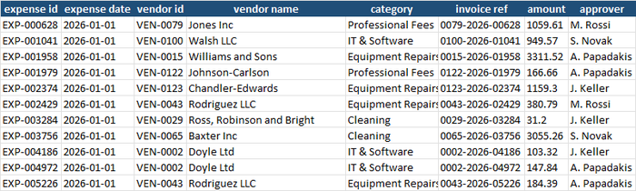
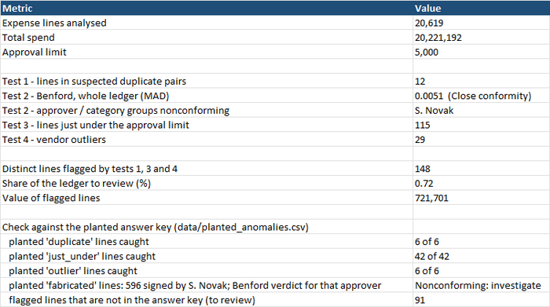
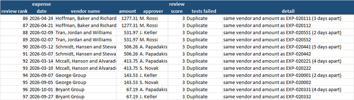
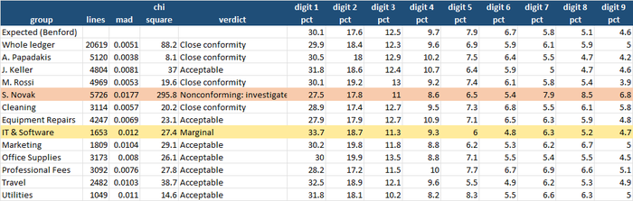
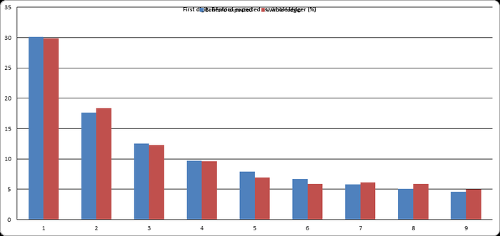
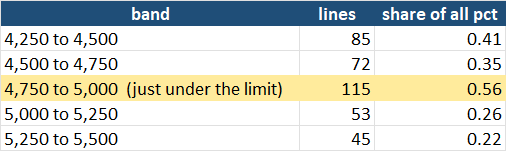
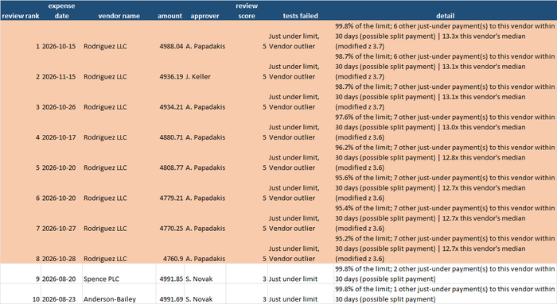
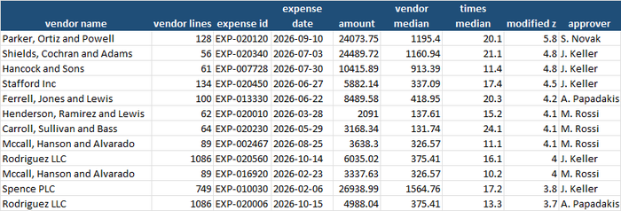

Ask the owner of a small company how they know the expenses in their books are right and the
answer is usually trust: "My bookkeeper checks everything," or "Anything over five thousand
needs my signature." Ask whether anyone has ever been paid twice for the same invoice, how
many payments landed just below that five-thousand line this year, and whether the amounts
one person approves look like the amounts everyone else approves, and the answer is usually
a pause.

Most problems in an expense ledger are not fraud. They are a supplier invoice keyed in twice
with a different reference, a large job split into three smaller bills so that it goes
through without a second signature "to save time", or a one-off payment that is ten times a
vendor's normal amount because of a typo. Occasionally they are fraud. In a small company
they are almost always found the same way: by accident, months later, when the money has
gone.

This blog keeps returning to one idea: replace gut feel with a number. The
[quality control](/2026/08/29/how-can-a-small-manufacturer-keep-quality-under-control/)
post asked whether a process was showing *normal* variation or a real signal; the
[supplier](/2026/11/21/which-suppliers-can-a-small-business-trust/) post scored the companies
you buy from. This post applies the same "is this normal?" question to the ledger itself —
**are there expenses in your books that shouldn't be there?** — with four simple tests:
**duplicate detection**, **Benford's law**, a check for payments **just under the approval
limit**, and **vendor outliers**.

December is the natural moment. The books are about to close, the accountant is about to
look at them, and a question asked now is a correction; the same question asked in April is
an awkward conversation.

One principle before the numbers: **a flag is a question, not an accusation.** Every test
below finds lines that *deserve a second look*. Many of them will have a perfectly good
explanation. The goal is to look at 150 lines on purpose instead of 20,000 by luck.

## What an expense anomaly screen actually gives you

| Benefit | Why it matters for an SME |
|---|---|
| **Duplicates found before the audit** | Same vendor, same amount, a few days apart — or the same invoice number typed slightly differently. The most common and most recoverable error in any ledger. |
| **A test for invented numbers** | Benford's law describes how the first digits of real-world amounts are distributed. Made-up numbers rarely follow it. The test works on groups — an approver, a category — and finds patterns no line-by-line review would see. |
| **Split payments made visible** | A cluster of payments just under the approval limit, especially to the same vendor within weeks, is the classic sign of a large spend broken up to avoid a second signature. |
| **Outliers judged against each vendor's own history** | A €5,000 payment is normal for one supplier and twenty times normal for another. The test compares each payment with that vendor's usual amounts. |
| **A short, ranked review list** | Every flagged line gets a score, so the review starts with the lines that failed more than one test. |
| **Bad data never reaches the tests** | A validation step rejects negative amounts, impossible dates and missing vendors or approvers first. |

## A practical example, using this repo's own results

This repository — **[expense-anomaly-detection-for-smes](https://github.com/MattProtopapas/expense-anomaly-detection-for-smes)**
— ships with a full worked example. The scenario is a fictitious company's expense ledger
from **1 January to 30 November 2026**: about **20,000 lines**, **150 vendors**, eight
categories (cleaning, repairs, IT, marketing, office supplies, professional fees, travel,
utilities) and **four approvers**. Payments above **€5,000** need a second approval.

Ordinary amounts are generated the way real spending looks: long-tailed, from a few euros to
a few tens of thousands. On top of that, four kinds of problem were planted, and recorded in
an answer key that the tests never read:

- **Duplicates:** six invoices paid twice, a few days apart, with the reference re-keyed
  (`0028-2026-24001` the first time, `0028/2026-24001` the second).
- **Split payments:** six cases of seven payments each, all just under €5,000, to one vendor
  within a few weeks.
- **Outliers:** six single payments 14 to 22 times a vendor's normal amount.
- **Invented amounts:** 600 claims, all signed off by one approver, with made-up amounts.

Having an answer key is a luxury a real ledger doesn't give you, but it lets us check
something important: how much each test finds, and how much it finds that *wasn't* planted.

The raw file has **20,661 rows**; the validator rejected **42** (negative amounts, impossible
dates such as month 13, missing vendors or approvers, and a duplicate expense ID), leaving
**20,619 lines** and **€20.2 million** of spend.



## The headline

The **Summary** tab shows how many lines each test flagged and checks them against the
answer key:



Of 20,619 lines, **148** were flagged by the line-level tests — **0.7%** of the ledger, worth
**€721,701**. Every planted duplicate, split payment and outlier was caught: **6 of 6**,
**42 of 42** and **6 of 6**. And the one approver who signed the invented claims is the only
group the Benford test marks as nonconforming. The other **91** flagged lines are not in the
answer key: they are the false alarms and the genuinely odd-but-innocent lines that any real
review has to wade through. More on them below.

## Test 1: duplicates

The duplicate test looks for two things: the **same vendor and the same amount within seven
days**, and the **same invoice reference once punctuation and capitals are ignored** — so
`0028-2026-24001` and `0028/2026-24001` count as one invoice.



Twelve lines were flagged — exactly the six planted pairs and nothing else. **Hoffman, Baker
and Richards** was paid **€1,277.31** twice, three days apart; **Tran, Jordan and Williams**
€531.97 twice, two days apart, approved by two *different* people — each of whom, reasonably,
thought they were approving a new invoice. That is how duplicates usually happen: not because
anybody is careless, but because two people each see half the picture.

Duplicates are the most valuable test per minute spent. They are common, easy to confirm, and
the money can usually be recovered with one email to the supplier.

## Test 2: Benford's law

In most real-world collections of amounts — invoices, expenses, populations, river lengths —
the first digit is **1** about **30%** of the time, **2** about 18%, and **9** only about
**5%**. This is Benford's law: the expected share of first digit *d* is log₁₀(1 + 1/*d*). It
holds whenever amounts span several orders of magnitude, which an expense ledger does.

People who invent numbers don't follow it. Asked to make up a "realistic" amount, people pick
middle and high first digits — 6s, 7s, 8s — far more often than chance.

The test compares the first-digit distribution of a group with the Benford curve using the
**mean absolute deviation** (MAD). Nigrini's widely used thresholds: below 0.006 is close
conformity, below 0.012 acceptable, below 0.015 marginal, and anything above is
**nonconforming**. The tool runs it on the whole ledger, on each approver and on each
category:





The whole ledger looks fine — MAD **0.0051**, close conformity. That is precisely the trap:
600 invented lines hidden in 20,000 genuine ones don't move the total enough to notice.

Split by approver, the picture changes. Three approvers have a MAD between **0.004 and
0.008**. **S. Novak** has **0.0177** — nonconforming — with 7s, 8s and 9s making up
**23.2%** of first digits against the **15.5%** Benford expects. Nothing about any single
one of those lines looks wrong; they are ordinary amounts to ordinary vendors. Only the
pattern gives them away, and only when the ledger is cut the right way.

One category, **IT & Software**, is *marginal* (MAD 0.012). That is a good example of what
not to over-read: it is a smaller group with a few large, round-ish licence payments, and
nothing was planted there. Marginal means "look if you have time"; nonconforming means "look".

## Test 3: payments just under the approval limit

If payments above €5,000 need a second signature, how many land between €4,750 and €5,000?
The **Threshold Check** tab compares that band with the bands on either side:



In a natural ledger the count falls steadily as amounts rise: **85** lines between €4,250 and
€4,500, **72** between €4,500 and €4,750. Then the band just under the limit jumps to
**115** — and the band just above it drops to **53**. Roughly fifty more payments sit just
below the line than the trend would predict. Someone is managing amounts to the limit.

The line-level test flags every payment from 95% up to the limit, and scores it higher when
the **same vendor** received other just-under payments **within 30 days** — the signature of a
split. The top of the review list is exactly that:



**Rodriguez LLC** received seven payments between **€4,760 and €4,988** in the second half of
October — about **€34,000** in total, none of which needed a second signature. Its usual
payment is about **€375**, so each of the seven is also flagged as an outlier: two tests
agreeing is the strongest signal on the list.

The approver column tells the rest of the story. Of the 115 just-under payments, **51** were
approved by one person, A. Papadakis, against 13 to 26 for each of the others — and five of
the six planted split-payment cases are theirs. Again, that is a question, not a verdict:
maybe one person simply handles the large maintenance contracts. But it is the first question
to ask.

## Test 4: vendor outliers

A payment is unusual only relative to what that vendor normally charges. For every vendor with
at least ten payments, the test measures how far each amount is from the vendor's median, on a
log scale, using a **robust z-score** (based on the median and the median absolute deviation,
so one huge payment cannot hide itself by inflating the average). Anything at **3.5** or more
is flagged:



All six planted outliers are on the list, and the two largest are at the top: **Parker, Ortiz and Powell** paid
**€24,073.75** against a median of €1,195 (20 times normal) and **Shields, Cochran and Adams**
**€24,489.72** against €1,161. So are a handful of genuine large payments — **Spence PLC**
received **€26,938.99**, 17 times its median, and nothing was planted there. In real life that
is probably an annual contract or a one-off project, and a reviewer confirms it in a minute.
That is the right trade-off: a test that never raises an innocent line also misses the real
ones.

## What the false alarms look like

Ninety-one flagged lines were not planted. They fall into three groups:

- **30 single payments just under the limit,** with no others to the same vendor that month.
  Low score, quick to clear.
- **42 just-under payments to large vendors** whose ordinary invoices are often in the
  €4,000–€5,000 range, so several land in the band in the same month by chance. They clear
  quickly once you know the vendor.
- **12 large one-off payments** flagged as outliers, like Spence PLC, plus the first half of
  each duplicate pair and one natural payment that happened to join the Rodriguez cluster.

That is the honest shape of any anomaly screen: everything real is in the list, and so is
some noise. The review score puts the real problems first — every line scoring 5 or more is
one of the planted cases or sits right next to one.

## The business impact, in real numbers

Put a number on what the workbook found:

1. **Six invoices were paid twice,** each pair approved in good faith — money recoverable with
   six emails.
2. **€34,000 to one vendor went through in seven payments,** each just under the limit, in two
   weeks; six such clusters in the year.
3. **About 50 more payments than expected sit just below €5,000** — the approval limit is
   shaping behaviour.
4. **One approver's amounts fail Benford's law** clearly, while the whole ledger passes —
   600 invented lines visible only when you split by person.
5. **Two payments of more than €24,000** were 20 times their vendor's normal amount.
6. **148 lines out of 20,619 — 0.7% — need a look.** That is an afternoon's review, not an
   audit.
7. **The data-quality dividend.** Forty-two impossible or duplicate lines were removed before
   any test ran.

## What to actually do with this, this week

1. **Export this year's expense lines:** date, vendor, amount, invoice reference, approver,
   category. Every accounting package can do this.
2. **Run the duplicate test first.** It is the quickest money back.
3. **Count payments in the band just under your approval limit,** and compare with the bands
   either side. A bump means the limit is being worked around.
4. **Run Benford by approver and by category,** not just on the whole ledger.
5. **Review the top-scoring lines with the person who approved them.** Ask, don't accuse —
   most will have an explanation.
6. **Fix the process, not just the lines:** require a second signature on cumulative spend to
   one vendor per month, not only per invoice, and block duplicate invoice numbers at entry.

## Try it yourself: a demo you can run in minutes

To make this concrete, **[expense-anomaly-detection-for-smes](https://github.com/MattProtopapas/expense-anomaly-detection-for-smes)**
is a small, self-contained, open-source Python pipeline. It:

1. Generates a fake 20,000-line expense ledger with natural-looking amounts, four kinds of
   planted anomaly with an answer key, and a configurable share of corrupted rows.
2. Validates every row against a strict schema, drops duplicate IDs and writes a rejection
   report.
3. Runs the four tests and writes the review list, the Benford analysis, the threshold check
   and the vendor outliers into a **6-tab Excel workbook**.

### Downloading the code (no Git experience needed)

You don't need to know Git or the command line to get the code onto your computer:

1. Go to the repository: **[github.com/MattProtopapas/expense-anomaly-detection-for-smes](https://github.com/MattProtopapas/expense-anomaly-detection-for-smes)**
2. Click the green **`<> Code`** button near the top of the page.
3. Click **"Download ZIP"** in the dropdown.
4. Right-click the downloaded ZIP and choose **"Extract All..."** to unzip it into a
   regular folder.
5. Open that folder — that's the project. Ask your AI tool of choice (I used Claude) to
   set up a Python environment and install the dependencies listed in
   `requirements.txt` — no coding experience required to get it running.

If you're comfortable with Git,
`git clone https://github.com/MattProtopapas/expense-anomaly-detection-for-smes.git` does the
same thing in one step.

### Running the demo

The repository includes a full `README.md`, but the short version, from PowerShell
(requires Python 3.10+; the tests use only the standard library):

```powershell
python -m venv .venv
.\.venv\Scripts\Activate.ps1
pip install -r requirements.txt

python generate_data.py --lines 20000 --vendors 150 --anomalies 24 --error-rate 0.002 --seed 42   # step 1: fake ledger + answer key
python validate_data.py                                                                         # step 2: schema checks, rejection report
python analyze_expenses.py                                                                      # step 3: four tests -> Excel
```

Then open `output/expense_review.xlsx`. With `--seed 42` you'll get exactly the numbers quoted
in this post; the workbook committed to the repository's `output/` folder was produced the same
way, so you can also just browse it on GitHub without running anything.

The test settings are all flags: `--approval-limit`, `--dup-days` (the window for same-amount
duplicates), `--just-under-pct` (where the just-under band starts), `--outlier-z`,
`--min-vendor-lines` and `--min-benford-lines`. Try `--outlier-z 3` to see how quickly the
review list grows when the outlier test is made more sensitive.

Every input and output path is defined in one place in `expense_common.py`, so once you're
comfortable with the demo you can drop your own expense export into `data/`, skip
`generate_data.py` entirely, and run `validate_data.py` and `analyze_expenses.py` straight on
your own ledger. Without an answer key the check against it is simply skipped.

> **Note:** the sample data shipped with this repo is synthetic and randomly generated, and
> every name in it is invented; this project is intended for educational and demonstration
> purposes only — see the repository's
> [Disclaimer & EULA](https://github.com/MattProtopapas/expense-anomaly-detection-for-smes/blob/main/DISCLAIMER.md)
> for details. It's a starting point for reviewing a ledger, not a fraud-detection or audit
> system.

## Understanding the results

The workbook — `output/expense_review.xlsx` — has six tabs.

**The headline.** *Summary* — lines flagged by each test, the Benford verdicts, the share and
value of the ledger to review, and the check against the answer key when there is one.

**The review list.** *Flagged Lines* — every flagged line with the tests it failed, a detail
column explaining why, and a review score; the highest first.

**The patterns.** *Benford* — first-digit shares for the ledger, each approver and each
category, with MAD, chi-square and a verdict, plus a chart. *Threshold Check* — the counts in
the bands around the approval limit. *Vendor Outliers* — payments far from each vendor's
normal amount.

**The input.** *Input Data* is the validated ledger exactly as the tests read it. Alongside
it, `data/validation_report.txt` lists every rejected row and why.

## The limits worth keeping in mind

Anomaly screening, like every tool covered on this blog, is genuinely useful within real
limits:

- **Flags are not findings.** Every test produces innocent hits. A flag starts a conversation;
  it never ends one.
- **Benford needs volume and range.** It works on groups of hundreds of lines spanning several
  orders of magnitude. It says nothing about a single line, or about a vendor who always
  charges the same fixed fee.
- **Clever splits avoid simple tests.** Splitting across different vendors, or keeping each
  payment well below the limit, won't show up here. The cumulative-spend control in the
  checklist above is the real defence.
- **Outliers depend on history.** A new vendor has no baseline, and a vendor with a steady
  ten-times-normal invoice every month will look normal.
- **The answer key is a luxury.** Real ledgers don't come with one, so tune the thresholds to
  a review list your team can actually work through.
- **This is not an audit.** It is a way to point a small team's limited attention at the right
  150 lines.

None of that diminishes the core value. The ledger already exists, the four tests run in
seconds, and the review takes an afternoon. What it changes is not that you trust your
people — you should — but that you also check, quietly and systematically, **before** the
books close and the accountant asks the same questions with a much bigger sample.
