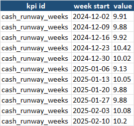
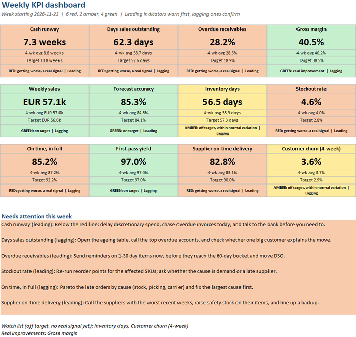
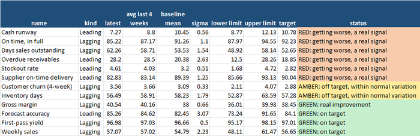
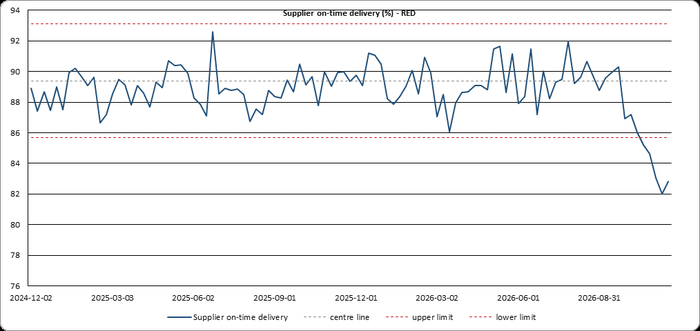
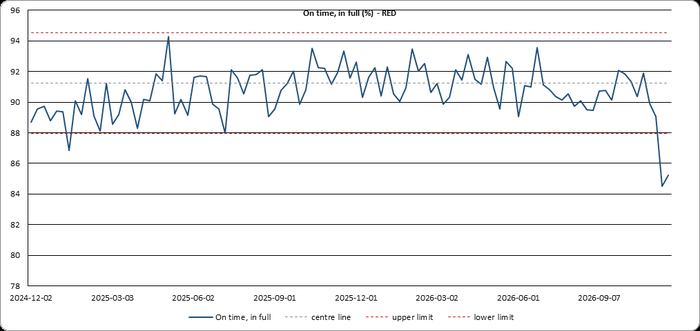
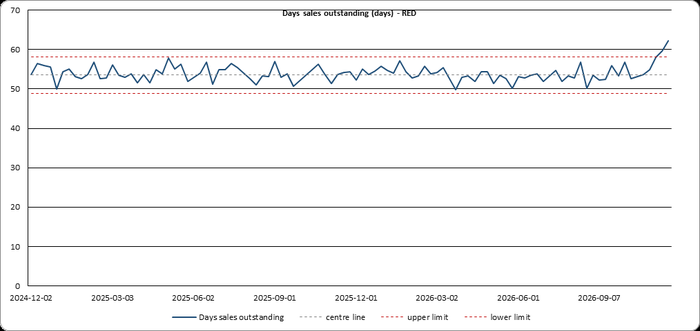
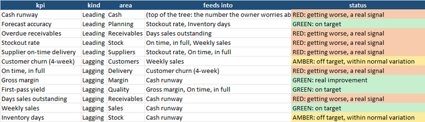
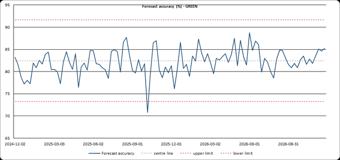
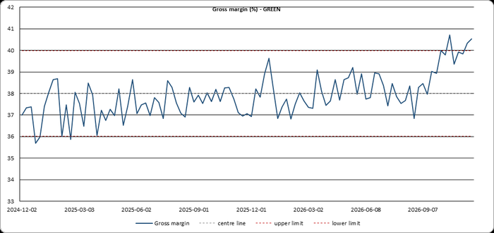

Ask the owner of a small company which numbers they look at every week and the answer is
usually either "sales and the bank balance" or a forty-tab spreadsheet nobody opens. Ask
which of those numbers would have warned them, a month in advance, that cash was about to
get tight; how they tell a bad week from the start of a bad trend; and what the target is
for each one and where it came from, and the answer drifts: "I just know when something's
off."

Usually, by the time you *know*, it has been off for a while. Sales and the bank balance are
the last numbers to move. By the time they do, the cause — a supplier slipping, a big
customer paying late, a product quietly losing money — has been visible somewhere else for
weeks, in a number nobody was looking at.

This blog has spent the year on one idea: replace gut feel with a number. Since July it has
covered [lead conversion](/2026/07/22/lead-conversion-analytics-for-small-companies/),
[inventory control](/2026/07/27/inventory-control-for-Small-and-Medium-companies/),
[market baskets](/2026/08/03/how-can-a-small-company-use-market-basket-analysis/),
[capital projects](/2026/08/08/how-can-companies-decide-which-capital-projects-to-fund/),
[customer segments](/2026/08/09/how-can-companies-profile-and-segment-their-customers/),
[working capital](/2026/08/27/how-much-working-capital-should-be-tied-up-in-inventory/),
[quality](/2026/08/29/how-can-a-small-manufacturer-keep-quality-under-control/),
[on-time delivery](/2026/09/07/are-your-orders-arriving-on-time-and-in-full/),
[forecasting](/2026/10/05/how-can-a-small-business-forecast-demand-for-next-month/),
[pricing](/2026/10/12/how-should-a-small-company-set-its-prices/),
[staffing](/2026/10/18/how-many-staff-do-you-actually-need-on-a-saturday/),
[A/B testing](/2026/10/23/did-that-promotion-actually-work-ab-testing-for-small-businesses/),
[depots and routes](/2026/11/01/where-should-we-put-the-depot-and-which-routes-should-our-vans-drive/),
[cash buffers](/2026/11/07/how-much-cash-does-a-small-business-need-to-avoid-running-short/),
[churn](/2026/11/14/which-customers-are-about-to-leave-and-is-it-worth-winning-them-back/),
[suppliers](/2026/11/21/which-suppliers-can-a-small-business-trust/),
[job scheduling](/2026/11/28/in-what-order-should-a-small-workshop-run-its-jobs/),
[product profitability](/2026/12/05/which-of-your-products-actually-make-money/),
[receivables](/2026/12/12/why-is-the-cash-from-your-sales-arriving-so-late/) and
[expense controls](/2026/12/19/are-there-expenses-in-your-books-that-shouldnt-be-there/).
Each one produced a number worth knowing. Nobody can watch twenty analyses every week.

So the last post of the year asks the question that ties them together: **what should be on
your one-page dashboard for 2027?** The answer uses four ideas: **leading and lagging
indicators**, a **KPI tree**, **targets set from your own history**, and **control-chart
thinking** to tell a real move from noise.

## What a one-page KPI dashboard actually gives you

| Benefit | Why it matters for an SME |
|---|---|
| **Twelve numbers instead of twelve reports** | One or two KPIs from each part of the business, on one page, every week. If it doesn't fit on one page, it won't get read. |
| **Early warning, not just a scoreboard** | Leading indicators — supplier delivery, overdue invoices, forecast accuracy — move weeks before the lagging ones like OTIF, DSO and cash. |
| **Cause and effect on the page** | A KPI tree shows which numbers feed which, so a red tile points to where to look. |
| **Targets you can defend** | Each target is the top quartile of your own last year: a level you have already reached, not a round number from a planning meeting. |
| **Signal separated from noise** | Control limits from each KPI's own week-to-week variation say whether this week's move is real. No more reacting to every wobble, and no more ignoring a real slide because "it's always up and down." |
| **An action for every tile** | Each KPI carries a short note on what to do when it turns red — written once, calmly, not invented in a crisis. |

## A practical example, using this repo's own results

This repository — **[kpi-dashboard-for-smes](https://github.com/MattProtopapas/kpi-dashboard-for-smes)**
— ships with a full worked example. The scenario is a fictitious small distribution
business with **104 weeks** of readings for **twelve KPIs**, up to the week starting
**23 November 2026**:

| Area | KPI | Type |
|---|---|---|
| Cash | Cash runway (weeks) | Leading |
| Receivables | Overdue receivables (%) · Days sales outstanding | Leading · Lagging |
| Margin | Gross margin (%) | Lagging |
| Sales | Weekly sales (€k) | Lagging |
| Planning | Forecast accuracy (%) | Leading |
| Stock | Stockout rate (%) · Inventory days | Leading · Lagging |
| Delivery | On time, in full (%) | Lagging |
| Quality | First-pass yield (%) | Lagging |
| Suppliers | Supplier on-time delivery (%) | Leading |
| Customers | Customer churn, 4-week (%) | Lagging |

Every one of them comes from an earlier post, and every one is something a small business
either already measures or can measure from data it already has.

A short story is planted in the last few weeks of the data, because a dashboard is only worth
building if it can tell a story like this one. A key supplier starts delivering late. A few
weeks later stockouts rise and on-time-in-full delivery drops. Separately, a large customer
starts paying late: overdue receivables jump, DSO follows, and cash runway falls. Gross margin,
meanwhile, keeps improving — a real, good change. And far back in the history, forecast
accuracy has one freak week that recovered by itself.

The data is long format — one row per KPI per week — and the validator rejected **13** of
**1,249** rows: blank values, impossible values such as −999, an impossible date, a mistyped
KPI name (`cash_runway_week`), and a duplicate reading for the same KPI and week.



## The dashboard

Here is the one page:



Each tile shows four things: the **latest** value, the **4-week average** (to steady the eye),
the **target**, and a **status** with whether the KPI is leading or lagging. Below the tiles
is the list that matters on a Monday morning: what to do about each red tile.

This week reads: **six red, two amber, four green.** That sounds alarming, and it is meant to:
the planted story is a bad month. But notice what the page does *not* say. It does not say
"everything is down". Sales are on target. Quality is on target. Margin is actually improving.
The problems are concentrated in two chains, and the next sections show how the page reveals
them.

## How a tile decides its colour

The status is not a matter of taste. For each KPI the tool takes a **baseline** — the 52 weeks
before the most recent eight — and works out:

- **The centre line:** the baseline average.
- **Sigma:** the typical week-to-week variation, measured around the baseline's own trend line
  so that a slow drift does not count as noise.
- **Control limits:** the centre line ± 3 sigma.
- **The target:** the **top quartile** of the baseline — the 75th percentile when higher is
  better, the 25th when lower is better. It is a level the business reached in one week out of
  four last year: a stretch, but a demonstrated one.

Then, as of the latest week, a KPI shows a **signal** — a real change rather than noise — if
any of three classic control-chart rules holds:

1. **The latest point is beyond 3 sigma.**
2. **Two of the last three points are beyond 2 sigma** on the same side.
3. **All of the last eight points are on the same side** of the centre line.

**Red** means a signal in the bad direction: act this week. **Amber** means no signal, but the
4-week average misses the target: watch it. **Green** means on target, or a signal in the good
direction — a real improvement.

That is the whole method, and it is the same idea as the
[quality control](/2026/08/29/how-can-a-small-manufacturer-keep-quality-under-control/) post,
applied to the business instead of the production line.



## Leading indicators warn first

Look at the first chain, which runs from suppliers to customers.

**Supplier on-time delivery** is a leading indicator: it moves before the things it causes.
Its control chart shows exactly how:



For almost two years it wandered between about 86% and 92% around a centre of **89.4%**. Then,
from early October, it started to slide — 86.9%, 87.2%, 86.0%, 85.2%, 84.6% — to **82.8%** in
the latest week. Every one of the last eight weeks is below the centre line, and the latest point
is beyond the lower control limit of **85.7%**. Three rules fire at once. This is not a bad
week; it is a supplier problem.

**On time, in full** is the lagging indicator downstream:



OTIF held up through October — 90–92%, normal — and only broke in mid-November, falling to
**84.5%** and then **85.2%**, well below its lower limit of **88.0%**. The stockout rate, in
between, rose to **4.6%** against a centre of 3.2%.

That sequence is the point of the whole dashboard. A business watching only OTIF found out in
mid-November. A business watching supplier on-time delivery saw it cross its lower limit in
the week of **26 October** — three weeks earlier — and could have raised safety stock on that supplier's items, or called
the backup the [supplier](/2026/11/21/which-suppliers-can-a-small-business-trust/) post
recommended qualifying. **Customer churn**, the next link in the chain, is amber: above target
but with no signal yet. If the delivery problem isn't fixed, that is the tile that turns red
next.

## The cash chain

The second chain runs from receivables to cash. **Overdue receivables** — the share of what
customers owe that is past due — jumped in the week of 12 October from about 20% to **30%**
and has stayed there (28.2% this week, against a centre of 20.4%). One large customer started
paying late.

**DSO** followed, more slowly, because it is an average over 90 days of sales:



It sat around **53.5 days** for most of the year, began creeping up in early November, and
reached **62.3** this week — beyond its upper limit of 58.1. **Cash runway**, at the top of the
tree, has fallen from about 10–11 weeks to **7.3 weeks**, below its lower limit of 8.8.

Again, the leading indicator moved first. Overdue receivables said "a customer has stopped
paying" five weeks before DSO crossed its limit and before the cash runway fell. The
[receivables](/2026/12/12/why-is-the-cash-from-your-sales-arriving-so-late/) post shows what
to do next: open the ageing table, find the customer, and call.

## The KPI tree: where to look when a tile turns red

The **KPI Tree** tab writes those chains down:



Read it from the bottom up: supplier on-time delivery and forecast accuracy feed the stockout
rate; stockouts and quality feed OTIF; OTIF feeds churn; churn feeds sales. On the money side,
overdue receivables feed DSO, and DSO, inventory days, gross margin and sales all feed cash
runway — the number the owner actually worries about.

The tree turns a red tile into a direction. When cash runway is red, the tree says: check DSO,
inventory days, margin and sales. This week, DSO is red and the others are not — so the cash
problem is a collections problem, not a sales or a stock problem. That single sentence saves
a week of guessing.

## Telling a real change from noise — both ways

Control-chart thinking protects you from two opposite mistakes.

**Reacting to noise.** Here is forecast accuracy:



In the week of 6 October 2025 it fell to **70.8%**, below the lower control limit. A manager
watching that number alone might have rebuilt the forecasting process. The next week it was
back to normal and it stayed there. A single point beyond the limits that recovers by itself
is worth a question ("was there a data problem that week?"), not a project. Today it is green
and on target at **85.3%**.

**Ignoring a real improvement.** Gross margin is the opposite case:



It has been above its centre line for eight weeks in a row and is now at **40.5%**, beyond the
upper limit of 40.0%. That is a *real* improvement, and the dashboard marks it green for that
reason, not because it beat a target. Real improvements deserve the same attention as real
problems: find out what changed — a price increase, a better product mix, a new supplier — and
make sure it sticks.

The two amber tiles, **inventory days** and **customer churn**, show the middle ground. Both
miss their targets, but neither shows a signal: the moves are within normal variation. The
right response is to watch them, not to act on them.

## The business impact, in real numbers

Put a number on what the dashboard found:

1. **Twelve numbers, one page.** Six red, two amber, four green — and the reds fall into two
   chains, not twelve separate problems.
2. **The supplier slide was visible three weeks before OTIF broke.** Supplier on-time delivery
   crossed its lower limit in late October on its way from 89% to 83%; OTIF only dropped below
   its limit in mid-November.
3. **The late-paying customer was visible five weeks before DSO crossed its limit.** Overdue
   receivables jumped from 20% to 30% in mid-October.
4. **Cash runway fell from about 10.5 weeks to 7.3,** and the tree points straight at DSO as the
   cause.
5. **Gross margin's rise to 40.5% is real,** not a lucky week — eight weeks in a row above the
   centre line.
6. **One freak week in forecast accuracy** did not need a response, and the control limits said
   so.
7. **The data-quality dividend.** Thirteen bad readings, including a mistyped KPI name, were
   removed before they could turn a tile the wrong colour.

## What to actually do with this, this week

1. **Pick twelve KPIs,** one or two per area of your business, and make at least four of them
   leading indicators. The table at the top of this post is a reasonable starting list.
2. **Pull 52 weeks of history** for each. Most of it already exists in your accounting,
   ordering and delivery systems.
3. **Set each target at the top quartile of last year,** not at a round number.
4. **Calculate the control limits** — the baseline average ± 3 times its week-to-week
   variation — and apply the three rules.
5. **Write the "what to do when it moves" note for each KPI now,** while nothing is red.
6. **Draw the KPI tree on one sheet of paper.** Which numbers feed which?
7. **Review it every Monday, in fifteen minutes.** Act on red, watch amber, ask what went right
   on a real green.

## Try it yourself: a demo you can run in minutes

To make this concrete, **[kpi-dashboard-for-smes](https://github.com/MattProtopapas/kpi-dashboard-for-smes)**
is a small, self-contained, open-source Python pipeline. It:

1. Generates two years of fake weekly readings for twelve KPIs, with the planted story above
   and a configurable share of deliberately corrupted rows.
2. Validates every row against the KPI catalogue — known KPI, plausible range, valid date, no
   duplicate week — and writes a rejection report.
3. Calculates control limits, targets and signals, and writes the one-page dashboard, the KPI
   detail, the KPI tree and a control chart per KPI into a **6-tab Excel workbook**.

### Downloading the code (no Git experience needed)

You don't need to know Git or the command line to get the code onto your computer:

1. Go to the repository: **[github.com/MattProtopapas/kpi-dashboard-for-smes](https://github.com/MattProtopapas/kpi-dashboard-for-smes)**
2. Click the green **`<> Code`** button near the top of the page.
3. Click **"Download ZIP"** in the dropdown.
4. Right-click the downloaded ZIP and choose **"Extract All..."** to unzip it into a
   regular folder.
5. Open that folder — that's the project. Ask your AI tool of choice (I used Claude) to
   set up a Python environment and install the dependencies listed in
   `requirements.txt` — no coding experience required to get it running.

If you're comfortable with Git,
`git clone https://github.com/MattProtopapas/kpi-dashboard-for-smes.git` does the same thing
in one step.

### Running the demo

The repository includes a full `README.md`, but the short version, from PowerShell
(requires Python 3.10+; the statistics use only the standard library):

```powershell
python -m venv .venv
.\.venv\Scripts\Activate.ps1
pip install -r requirements.txt

python generate_data.py --weeks 104 --error-rate 0.01 --seed 42   # step 1: fake weekly KPI readings
python validate_data.py                                          # step 2: schema checks, rejection report
python analyze_kpis.py                                           # step 3: limits, targets, signals, dashboard -> Excel
```

Then open `output/kpi_dashboard.xlsx`. With `--seed 42` you'll get exactly the numbers quoted
in this post; the workbook committed to the repository's `output/` folder was produced the same
way, so you can also just browse it on GitHub without running anything.

The analysis step takes two settings: `--recent-weeks` (the window checked for signals, 8 by
default) and `--baseline-weeks` (the history behind the limits and targets, 52 by default).

The twelve KPIs — their names, whether higher or lower is better, their plausible range, what
drives them and what to do when they move — are defined in one place, `kpi_common.py`. Edit that
catalogue to describe your own KPIs, put your own weekly readings into `data/` in the same long
format (KPI, week, value), skip `generate_data.py`, and run `validate_data.py` and
`analyze_kpis.py` straight on your own numbers.

> **Note:** the sample data shipped with this repo is synthetic and randomly generated, and
> this project is intended for educational and demonstration purposes only — see the
> repository's
> [Disclaimer & EULA](https://github.com/MattProtopapas/kpi-dashboard-for-smes/blob/main/DISCLAIMER.md)
> for details. It's a starting point for designing a KPI dashboard, not a business-intelligence
> system.

## Understanding the results

The workbook — `output/kpi_dashboard.xlsx` — has six tabs.

**The page.** *Dashboard* — the twelve tiles, the actions for the red ones, the watch list and
the real improvements.

**The reasoning.** *KPI Detail* — for every KPI the latest value, the 4-week average, the
centre line, sigma, the control limits, the target, the gap to target, the status, which rule
fired, what drives it, what to do, and the blog post it comes from. *KPI Tree* — which KPIs
feed which.

**The pictures.** *Charts* — a control chart per KPI: the weekly value, the centre line and
both limits. *Control Data* holds the numbers behind them.

**The input.** *Input Data* is the validated readings exactly as the analysis read them.
Alongside it, `data/validation_report.txt` lists every rejected row and why.

## The limits worth keeping in mind

A KPI dashboard, like every tool covered on this blog, is genuinely useful within real limits:

- **Seasonal KPIs need a seasonal baseline.** Sales in December should be compared with last
  December, not with the year's average. The demo's series are not seasonal, to keep the idea
  simple; for yours, compare with the same weeks last year.
- **Targets from history assume history was acceptable.** If last year was a bad year, its top
  quartile is a low bar. Use the method for a starting point, then adjust with judgement.
- **Control limits need a stable baseline.** If the baseline year itself contained a big change,
  the limits will be too wide. Rebuild them after a deliberate change in the process.
- **Weekly data is noisy for small businesses.** If you have few transactions a week, use a
  4-week rolling figure — like the churn KPI here — or move to monthly.
- **Twelve is a ceiling, not a target.** Five well-chosen numbers watched every week beat twenty
  ignored ones.
- **The tree is a hypothesis.** Which KPI drives which is your best understanding of the
  business. When a red tile doesn't fit the tree, the tree is what needs updating.

None of that diminishes the core value. The data already exists; the limits and targets are a
few columns in a spreadsheet; the page takes an afternoon to design and fifteen minutes a week
to read. What it changes is not that you have numbers — you always had numbers — but that you
see the problem in the leading indicator, weeks **before** it reaches the bank balance, and
you know which twelve numbers to look at to find it.

Thank you for reading this year. Here's to a 2027 run on numbers rather than gut feel.
